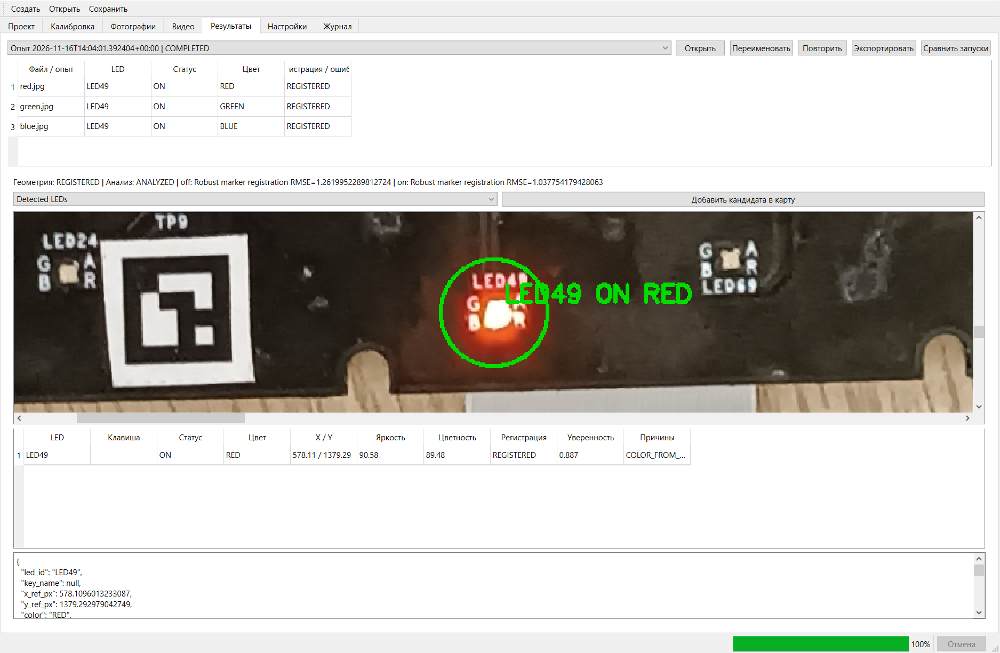
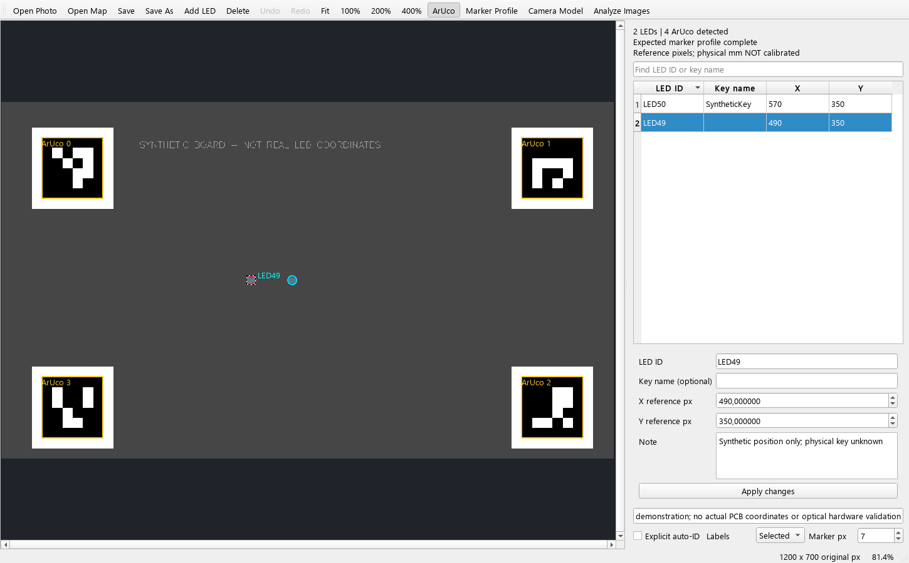

# GS75_RGB_Research

## RGB Vision v0.4.1 — видеоэксперимент LED49 через GUI

`Start_RGB_Vision.bat` → **«Видеоэксперимент»** → выбрать COM (например COM19)
→ **«Подключить»**. После PING/INFO/STATUS/ADCSTATUS/SELFTEST начать запись
на телефоне, нажать **«Запустить эксперимент»** и подтвердить физические
условия. Открытие программы и подключение ничего не включают.

Сценарий: **OFF 5 с → RED 5 с → OFF 3 с → GREEN 5 с → OFF 3 с → BLUE 5 с →
OFF 5 с**, план 31 с плюс обмен. Каждый цвет — один PHOTO LED49, отдельный
ограниченный ARM, проверка ACK/DONE/тока/ADC, затем OFF/STATUS.
Красная **«Прервать / OFF»** прерывает ожидание; ошибки прекращают сценарий.
Требуются U13 OPEN, R1=2700 Ом, исследуемая плата и присутствие оператора.
**IWDG выключен: питание должно быть физически доступно.**

Сессия автоматически сохраняется в `results/video_experiments/`: JSON,
полный TX/RX JSONL, электрический CSV и Markdown. MP4/MOV добавляется ссылкой;
есть просмотр и передача в прежний Benchmark. Медиа автоматически в Git
не добавляются. Зависимости обновить по requirements-vision.txt: pyserial 3.5.

[Руководство и первое испытание](docs/vision/video_experiment.md) ·
[Скриншот вкладки](docs/vision/screenshots/v041_video_experiment.png) ·
[JSON имитатора](docs/vision/examples/v041_simulated/session.json).
Новое GUI проверено программно и ещё требует аппаратной приёмки.
По последнему сообщению оператора FW 0.1.2 PHOTO уже проверена на стенде:
RED до 10000 мс, BLUE 1000 мс, GREEN визуально. Прошивка в v0.4.1 не менялась.
Ниже сохранена история прежних этапов.

## RGB Vision v0.4-perf — измерения видео и автоматический OFF

В прежнем `Start_RGB_Vision.bat` появилась вкладка **«Производительность видео»**:
выбрать MP4 → задать OFF-интервал (по умолчанию первые 2 с) →
**«Измерить производительность»**. Есть стадии, Mean/P50/P95/P99/max,
decode/compute/сквозной FPS, CPU/RSS, график и экспорт JSON/CSV/Markdown.
Зависимости обновить по requirements-vision.txt; добавлен PyAV для PTS/VFR.

OFF строится медианой независимо совмещённых пригодных кадров с маской
наблюдений. Плохие кадры/свечение/движущиеся объекты отклоняются;
обновление требует гарантированного OFF и запрещено во время свечения.
Все измеренные кадры декодируются последовательно, без пропусков ради FPS.

На **синтетических** 1080p/1440p/4K гибрид KNOWN_LEDS дал mean
21,6 / 23,3 / 30,1 ms; DISCOVER 1080p — 58,4 ms. 30 FPS для реального
смартфона не подтверждены: видео пользователя пока нет, реальная карта
крупнее синтетической, fallback и худшие кадры выходят за бюджет.

[Инструкция и ограничения](docs/vision/video_performance.md) ·
[Фактические таблицы/графики](docs/vision/perf_v04/report.md).
Прошивка, исходные медиа, карта и прежние аппаратные результаты не менялись.
Следующие разделы описывают сохранённые функции v0.3 и историю проекта.

## GS75 RGB Vision v0.3 — единое приложение Windows

**Запуск одним действием:** дважды щёлкнуть `Start_RGB_Vision.bat`.
GUI использует существующий `.venv/Scripts/pythonw.exe`, без постоянного
терминала. Ошибки — в приложении и `logs/rgb_vision.log`. Если окружения
ещё нет, один раз установить зависимости:

```powershell
python -m venv .venv
.\.venv\Scripts\python.exe -m pip install -r requirements-vision.txt -r tools/requirements.txt
```

В обычной работе PowerShell не нужен:

1. «Проект» → создать JSON проекта → выбрать карту
   `config/gs75_board_calibration.json` или подготовить новую в «Калибровке».
2. «Фотографии» → «Добавить фотографии» → выбрать сразу OFF/RED/GREEN/BLUE
   либо перетащить их из Проводника.
3. Назначить одному фото OFF, остальным ON. Цвет из имени не выводится.
4. Нажать **«Анализировать выбранные ON»**. Получить таблицу, отдельные
   отчёты пар, общий JSON/CSV, историю и диагностические слои.

На настоящих текущих фотографиях через GUI получены **LED49 RED/GREEN/BLUE**,
OFF/OFF → OFF. BLUE→MIXED исправлено по новому сигналу относительно OFF;
настоящие смеси и неопределённость сохранены. Прошивка в v0.3 не менялась.



«Видео»: MP4/MOV/AVI при наличии декодера, Play/Pause, seek, покадровый
просмотр и «Кадр как OFF/ON». Выбранные кадры попадают в фотонабор без
ручного экспорта. Полного автоматического видеоанализа, камеры и управления
STM32 пока нет.

[Руководство GUI](docs/vision/gui_guide.md) · [Видео](docs/vision/video_import.md) ·
[Архитектура](docs/vision/gui_architecture.md) · [Приёмка](docs/vision/v03_validation.md).
Старые CLI сохранены. Фото/видео, карту и проект JSON переносить отдельно
с сохранением структуры путей. Большие медиа автоматически в Git не включаются.
Следующие разделы FW/Vision v0.2 описывают предшествующий этап.

Для продолжения на другом компьютере или в новом сеансе VSCode:
[контекст проекта, статус испытаний и команды переноса](PROJECT_CONTEXT.md).

Диагностическая прошивка STM32F411RET6 для исследования контактов RGB-платы
MSI GS75. Независимый проект; [основной проект клавиатуры](https://github.com/AlexeyNV/GS75_Keyboard)
изучен как пример организации HAL, USB и host-тестов и не изменялся.

**Первый запуск — без оригинальной RGB-платы и с разомкнутой U13.**

## FW 0.1.2 PHOTO и RGB Vision v0.2

Добавлена команда `PHOTO LED49 RED|GREEN|BLUE 100…10000` с прежними
защитами ADC/тока/ARM/OFF. PAIR остаётся 10–300 мс. Новая FW собрана и
проверена программно; аппаратно подтверждённой остаётся **FW 0.1.1**.
[DFU, ограничения watchdog и первые испытания](docs/photo_mode.md).

```powershell
.\.venv\Scripts\python.exe tools/photo_led49.py --port COM19 --color red --duration-s 5
```

Запускает оператор после подготовки платы и обновления прошивки; перед ARM
нужно подтверждение PHOTO. Полный TX/RX сохраняется в новый JSONL.

На реальных OFF/RED: **LED49 ON/RED**, один кандидат DISCOVER, OFF/OFF без
нового свечения. Известные LED анализируются по ROI; цвет определяется по
ореолу вокруг белого ядра. DISCOVER не назначает ID автоматически.
[Фактический отчёт и причина прежних 44/0](docs/vision/real_validation.md).

```powershell
.\.venv\Scripts\python.exe tools/analyze_images.py --mode KNOWN_LEDS --calibration config/gs75_board_calibration.json --off data/off.jpg --on data/red.jpg --output build/vision/new_red_run
.\.venv\Scripts\python.exe tools/validate_real_images.py --output build/vision/new_validation_run
```

Реальные фото и карта остаются локальными: перенести их отдельно с сохранением
путей и SHA-256. При их отсутствии реальные тесты явно пропускаются;
синтетические данные их не заменяют. Настоящие GREEN/BLUE пока не проверены.

## ArUco и графический калибратор

Реализованы печатные ArUco 10/12/15 мм, Qt-калибратор с zoom/pan,
редактированием LED ID/клавиш, Undo/Redo и autosave, а также независимое
совмещение OFF/ON-фотографий и поиск оптических кандидатов. Без видео,
камерного захвата и автоматической синхронизации со STM32; PHOTO запускается отдельно.

```powershell
python -m venv .venv
.\.venv\Scripts\python.exe -m pip install -r requirements-vision.txt -r tools/requirements.txt
.\.venv\Scripts\python.exe tools/generate_markers.py --size-mm 10 --count 10 --output build/markers
.\.venv\Scripts\python.exe tools/board_calibrator.py
```

Печатный лист: `build/markers/aruco_A4.pdf` и `.svg`, масштаб печати 100%.
В калибраторе Open Photo → Add LED → щелчок по центру → явно задать
LED ID и при необходимости Key Name → Save в config/gs75_board_calibration.json.
LED49 не имеет известного названия клавиши: его можно оставить пустым.
Координаты — пиксели оригинального эталона, а не окна или физически точные мм.

Для демонстрации без настоящих снимков:

```powershell
.\.venv\Scripts\python.exe tools/board_calibrator.py --calibration examples/vision/synthetic/calibration.json
.\.venv\Scripts\python.exe tools/analyze_images.py --calibration examples/vision/synthetic/calibration.json --off examples/vision/synthetic/off.png --on examples/vision/synthetic/red.png --output build/vision/demo_red
```



[Печать и размещение меток](docs/vision/marker_printing.md) ·
[Работа с калибратором](docs/vision/calibration_guide.md) ·
[Анализ OFF/ON и экспорт](docs/vision/image_analysis.md) ·
[Архитектура, проверки и ограничения](docs/vision/architecture.md).
Генерация, GUI и анализ проверены программно; настоящие OFF/RED проверены,
настоящие GREEN/BLUE ещё не проверены. Большие
пользовательские фотографии автоматически в Git не включаются.

## Статус

Новое подтверждение на настоящей RGB-плате: LED49 имеет A=KP14,
R=KP32/100 Ом, G=KP33/16 Ом, B=KP34/75 Ом. При PAIR длительностью 100 мс
светился только LED49 нужным цветом: 1033/886/794 мкА, по 99 отсчётов,
FAULT=NONE, REASON=TIMEOUT. U13 OPEN, R1=2700 Ом. Подробности:
[топология](docs/rgb_topology.md), [журнал](docs/hardware_validation.md).
Остальные LED и точность измерений этим не подтверждены.

## Полуавтоматический probe

`tools/rgb_probe.py` поддерживает фиксированный SOURCE или SINK, CSV/JSON,
кандидатов по диагностическому порогу тока и остановку при ошибках.
Сначала режим без устройства:

```powershell
python tools/rgb_probe.py --simulate --source 14 --pins 32,33,34 --output build/probe_demo/led49
python tools/rgb_probe.py --simulate --source 14 --pins 1-40 --output build/probe_demo/source14
```

После подготовки оператор может явно запустить 39 пар SOURCE=14:

```powershell
python tools/rgb_probe.py --port COM19 --source 14 --pins 1-40 --confirm-scan --arm-seconds 60 --output results/rgb_source14_run01
```

По умолчанию 150 мс, пауза 500 мс, порог кандидатов 100 мкА, предел
остановки 1800 мкА. Начало требует подтверждения, проверок и одного ARM;
автоматического повторного ARM нет. Совпадающие контакты исключаются.
Ток не доказывает свечение. Реальный scan новым инструментом ещё не выполнен.
[Полные инструкции и форматы результатов](docs/rgb_probe.md).

## Статус реализации и проверок

| Статус | Результат |
|---|---|
| Implemented | FW 0.1.2 PHOTO, photo_led49, rgb_probe; RGB Vision v0.2 KNOWN_LEDS/DISCOVER, ArUco и Qt-калибратор |
| Build verified | ARM GCC 14.3.1, CubeF4 1.28.3, CMake/Ninja; ELF/BIN/HEX собраны; host-тесты MSVC и проверка соединений EasyEDA |
| Hardware verified | FW 0.1.1 записана через USB DFU; подтверждены USB CDC, ADC, SELFTEST, KP35↔KP27 на 1 кОм, OFF по USB CDC и три цвета только LED49. Остальные каналы, физические фронты EN и точность тока ещё не проверены |

Протокол: [docs/hardware_validation.md](docs/hardware_validation.md).
ADCSTATUS: SAMPLES=VALID_SAMPLES=146796, ERRORS=0, OVR_COUNT=0,
AGE_MS=0, VALID=1. На нагрузке получены средние токи 1249/1253 мкА
для PAIR 35 27 300 и 1254/1254 мкА для PAIR 27 35 300; каждый опыт
содержал 299–300 отсчётов, FAULT=NONE, REASON=TIMEOUT. После испытаний
STATUS=IDLE, SRC_EN=0, SNK_EN=0. Это не проверка всех 40 контактов
и не подтверждение точности калибровки.

16.11.2026 оператор успешно проверил OFF с запрошенными задержками 50 и
100 мс после ACK для `PAIR 27 35 300`: получены 67/115 отсчётов,
средний ток 1254 мкА в обоих опытах, REASON=OFF, FAULT=NONE.
Последующий STATUS — DISARMED, SRC_EN=0, SNK_EN=0. Скрипт
[tools/test_off.py](tools/test_off.py) и исходные протоколы
[50 мс](results/off_test_50ms.json), [100 мс](results/off_test_100ms.json)
сохранены в репозитории. Это проверка прерывания по USB-протоколу;
физическое время выключения ключей осциллографом не измерялось.

`.ioc` содержит конфигурацию для CubeMX; открытие и регенерация в GUI ещё не
проверены. Проверяемый исходный проект — CMake с включёнными в репозиторий
официальными библиотеками ST. Подробнее: [firmware/README.md](firmware/README.md).

## Аппаратура

U21 — STM32F411RET6, LQFP64, питание 3,3 В; U22 — кварц 8 МГц.
U1–U5 (74HCT4051) подключают SOURCE, U6–U10 — SINK. U11/U12 (74HCT138)
выбирают один из пяти банков. Логика HCT питается от USB 5 В.
FPC1 имеет 40 сигнальных контактов KP1–KP40 и два контакта экрана GND.
R1=2,7 кОм ограничивает ток, R2=100 Ом измеряет его, R3=1 кОм и C15=10 нФ
образуют входную цепь ADC. R18=1,5 кОм с U13 — дополнительная ветвь,
в первой версии U13 должна быть разомкнута.

`channel=(pin-1)%8`, `bank=4-(pin-1)/8`. Формула проверена по исходной
EasyEDA-схеме для обеих групп. Перед сменой адресов обе группы отключаются;
после пауз 10 мкс на отключение и 10 мкс на установление адреса включается
сначала SINK, затем SOURCE. Таблицы и источники: [docs/hardware.md](docs/hardware.md),
[docs/pin_mapping.md](docs/pin_mapping.md).

## Сборка и прошивка

В терминале с ARM GCC, CMake и Ninja в PATH, из корня проекта:

```powershell
cmake -S firmware -B build/firmware -G Ninja '-DCMAKE_TOOLCHAIN_FILE=cmake/arm-gcc.cmake'
cmake --build build/firmware
STM32_Programmer_CLI -c port=SWD -w build/firmware/GS75_RGB_Research.elf -v -rst
```

Последняя команда требует физического ST-Link и подготовленной платы; здесь
не выполнялась. ELF/BIN/HEX находятся в `build/firmware/` и не включаются в Git.
Сборка не требует скачивания SDK. CubeIDE: импортировать CMake-проект, выбрать
STM32 toolchain и файл `firmware/cmake/arm-gcc.cmake`; импорт в GUI не проверен.

## USB CDC

```powershell
python -m pip install -r tools/requirements.txt
python tools/serial_console.py --port COM7
```

Начать с `PING`, `INFO`, `ADCSTATUS`, `CURRENT`, `SELFTEST`, `STATUS`.
В DISARMED счётчик SAMPLES должен увеличиваться примерно на 1000 в секунду,
AGE_MS оставаться малым, ERRORS/OVR_COUNT/TIMEOUTS не расти, VALID=1.
Причина и проверка исправления описаны в [docs/adc.md](docs/adc.md).
Только после проверки приборами
и установки контрольного резистора 1 кОм между испытанными KP27/KP35:

```text
ARM 60
PAIR 35 27 300
CURRENT
OFF
```

PAIR выдаёт `ACK ID=…`, затем асинхронный `DONE ID=…` с фактическими выборками
ADC. При отсутствии выборок передаётся `MEASUREMENT=UNAVAILABLE`.
`OFF` прекращает импульс и снимает ARM. Протокол описан в
[docs/protocol.md](docs/protocol.md).

## Проверки

```powershell
.\.venv\Scripts\python.exe -m unittest discover -s tests -p 'test_*.py' -v
cmake -S tests -B build/host -G 'Visual Studio 17 2022' -A x64
cmake --build build/host --config Debug
ctest --test-dir build/host -C Debug --output-on-failure
```

Host-тесты компилируют настоящий прикладной C-код; GPIO заменены моделью.
На Linux можно использовать обычный GCC и генератор Ninja. Итоги и ограничения:
[docs/verification.md](docs/verification.md).

## Ограничения и дальнейшие шаги

PAIR 10–300 мс; PHOTO только LED49 100–10000 мс. ARM максимум 60 с, аварийный предел 2000 мкА.
Пределы задаются только при компиляции в `board_config.h`.
Первые три цвета LED49 оригинальной RGB-платы подтверждены. Точность ADC не калибрована;
нулевой ADC не доказывает исправность цепи. Программная защита не заменяет R1.
VID/PID 0483:5740 используются только для прототипа; собственного USB VID нет.
Непроверенными остаются физические фронты и задержка отключения EN при
OFF/Reset/авариях, остальные каналы, точность измерения тока и подключение
остальных LED оригинальной RGB-платы MSI и реальная серия rgb_probe.
Следующий этап — ограниченные операторские серии и уточнение карты по
току и отдельным визуальным наблюдениям. Контекст и измерения:
[PROJECT_CONTEXT.md](PROJECT_CONTEXT.md). Порядок проверок: [docs/bringup.md](docs/bringup.md),
текущие результаты: [docs/hardware_validation.md](docs/hardware_validation.md).
GUI фото-калибровки и фотоанализ реализованы отдельно от rgb_probe.
Видео, захват камеры, PWM и синхронизация со STM32 не реализованы.
