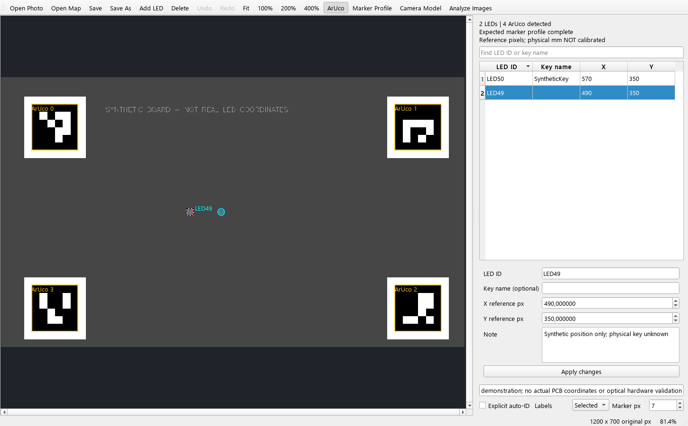

# Графический калибратор RGB Vision v0.1

**v0.3:** редактор встроен во вкладку «Калибровка» приложения
`Start_RGB_Vision.bat`. Описанные ниже действия сохранены; старый CLI
вспомогательный. [Проекты, импорт и анализ через GUI](gui_guide.md).
Перед анализом сохраните карту. Проект исследования и карта — разные JSON;
схема карты остаётся v1. Анализ новых фото не меняет координаты.

## Установка и запуск

Из корня репозитория, в PowerShell:

```powershell
python -m venv .venv
.\.venv\Scripts\python.exe -m pip install -r requirements-vision.txt -r tools/requirements.txt
.\.venv\Scripts\python.exe tools/board_calibrator.py
```

Для воспроизведения проверенного Windows/Python 3.12 окружения вместо
requirements-vision.txt можно установить requirements-vision-lock.txt.
Не требуется ни COM-порт, ни камера, ни подключение STM32.
Можно начать с небольшого синтетического примера:

```powershell
.\.venv\Scripts\python.exe tools/board_calibrator.py --calibration examples/vision/synthetic/calibration.json
```



## Создание реальной карты

1. При необходимости до загрузки снимка выбрать Camera Model с известными
   intrinsics. Без такой информации оставить модель пустой, не выдумывать её.
2. Open Photo (Ctrl+I) — выбрать JPG/JPEG/PNG/TIF/TIFF. Указаны фактические
   размеры. EXIF-ориентация нормализуется; само фото не изменяется.
   Проверена загрузка 8000×6000. Внешние снимки копируются в data/reference/.
3. ArUco обнаруживаются автоматически, показываются контуры/ID и число
   маркеров. Marker Profile позволяет загрузить markers_manifest.json
   печатного листа. По умолчанию ожидаются ID 0…9, размер 10 мм номинально.
   Предупреждение о пропавших маркерах не запрещает сохранение остальных.
4. Колесо масштабирует вокруг курсора, фон перетаскивается левой кнопкой,
   средняя кнопка панорамирует в любом режиме. Fit/F, 100%, 200%, 400%; колесом
   до 6400%. Fit подстраивается при resize, выбранный вручную zoom сохраняется.
   Координаты под курсором — исходные пиксели эталона, не пиксели окна.
5. Включить Add LED (A), щёлкнуть центр LED. В диалоге явно указать LED ID
   по маркировке PCB, например LED49. Key name оставить пустым, если клавиша
   неизвестна. Несколько LED могут иметь одно название клавиши. Можно добавить note.
6. Автонумерация изначально выключена. Только явная галочка Explicit auto-ID
   предлагает следующий числовой ID; он не вычисляется из положения на плате.
   Предыдущее введённое название клавиши остаётся в следующем диалоге для
   редактирования и подтверждения, а не считается автоматически доказанным.
7. Выключить Add LED для выбора/перетаскивания точек. Щелчок выбирает LED,
   двойной щелчок переводит фокус в редактор. Справа можно изменить ID, key,
   X/Y и note, затем Apply changes. Перетащенная точка сохраняется в модели;
   выход за границу и дубли ID отклоняются без частичного изменения карты.
8. Таблица сортируется щелчком заголовка, поиск фильтрует ID и key name.
   Выбор строки подсвечивает и центрирует LED. Подсказка на точке показывает
   ID, key, координаты и note. Labels: Selected по умолчанию, All или None;
   для плотной карты оставлять Selected. Marker px меняет только размер
   экранного кружка, не координаты или радиус детектора.
9. Ctrl+Delete/кнопка Delete удаляет выбранный LED; Ctrl+Z/Ctrl+Y — Undo/Redo
   для добавления, изменения, переноса, удаления и настроек карты (до 500 действий).
   Комментарий проекта применяется по Enter в поле комментария.
10. Save/Ctrl+S — сохранить config/gs75_board_calibration.json, Save As —
    отдельную копию. Open Map/Ctrl+O восстанавливает карту с проверкой checksum.

Разметить всю плату можно без назначения клавиш: LED ID и Key Name независимы.
Ни номер LED по положению, ни клавиша не угадываются программой. Разрешено
сохранить карту даже без ArUco, но фотоанализ тогда не сможет надёжно
зарегистрировать новые снимки.

## Автосохранение и перенос

Каждые 30 секунд изменённая карта сохраняется как `<map>.autosave.json`.
Для ещё не сохранённого проекта черновик находится в build/vision/autosave/;
его путь показывается в строке состояния. Черновики не включаются в Git.
Open Map умеет открыть такой JSON. При открытии карты с более новым
черновиком рядом предлагается восстановление. Черновик не заменяет явный
Save. При закрытии/смене проекта есть Save / Discard / Cancel.

Формат и правила переноса фото: [config/README.md](../../config/README.md).
Карта хранит относительный путь и SHA-256 оригинала; на другом компьютере
нужны и JSON, и то же фото. Обработка использует 8-битный RGB/BGR; TIFF
поддерживается как цветная фотография, не как метрологический 16-битный RAW.

Координаты — пиксели EXIF-нормализованной эталонной фотографии (при заданной
модели объектива — после undistort). Их нельзя называть физически точными мм.
LED49 из синтетического примера имеет вымышленные координаты и неизвестную
реальную клавишу. Для своей платы обязательно указать настоящий центр мышью.
