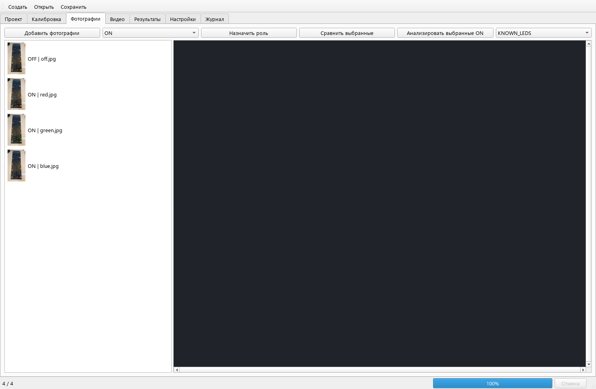
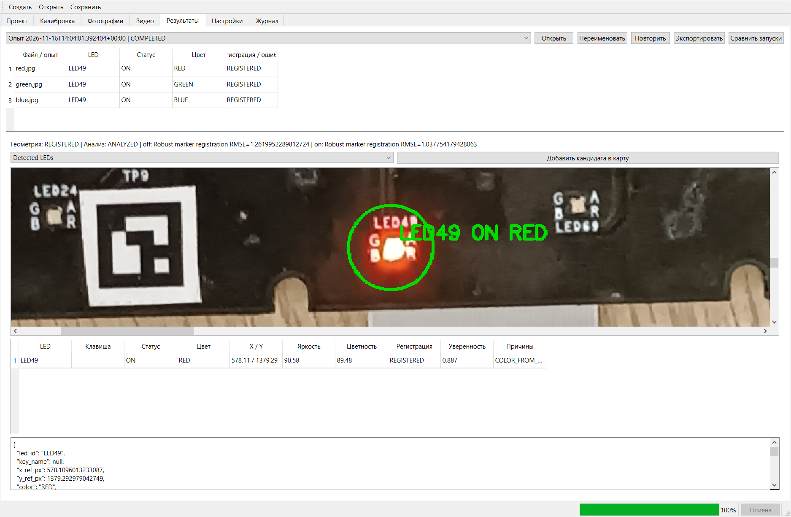

# GS75 RGB Vision v0.3 — работа через интерфейс Windows

Обычный запуск: дважды щёлкнуть **Start_RGB_Vision.bat** в корне репозитория.
Используется `.venv/Scripts/pythonw.exe`; постоянного терминала нет.
Отсутствующие зависимости показываются сообщением; установка автоматически
не запускается. Если окружение ещё не подготовлено, один раз выполнить
инструкцию установки из README. Ошибки пишутся в `logs/rgb_vision.log`,
в работе доступны вкладка «Журнал» и сообщения с причиной.

## Проект и калибровка

1. Во вкладке «Проект» нажать «Создать проект» и выбрать новый JSON-файл,
   например `gs75_rgb_vision_project.json`. Существующий файл не заменяется.
2. Нажать «Использовать предложенную карту» либо «Выбрать карту калибровки».
   Для текущей платы выбрать `config/gs75_board_calibration.json`.
   Предложение не загружается молча. Проверяются формат, версия, SHA-256
   карты и эталона, размеры изображения. Неподходящий проект даёт ошибку.
3. Во вкладке «Калибровка» сохранены прежние zoom/pan, ArUco, Add LED,
   ID, название клавиши, drag, Undo/Redo, поиск, autosave. Названия клавиш
   независимы от PCB ID; пустое название допустимо. Дубликаты ID отклоняются.
   Колесо — масштаб, средняя кнопка — pan. Полный размер изображения
   сохраняется в системе reference_px.
4. Для новой платы открыть «Эталон», расставить LED мышью, сохранить карту.
   При замене эталона существующие несохранённые изменения требуют решения.
   Перед анализом изменения карты необходимо сохранить.

Карта v1 совместима с прежней LED49. Проект исследования — отдельный JSON:
ссылки на карту/эталон, версии и hash, роли медиа, история, настройки и путь
последнего импорта. Относительные ссылки могут включать `../`; для разных
дисков Windows остаётся абсолютная ссылка. При переносе нужны также сами
файлы, а не только JSON. «Найти перемещённые файлы» восстанавливает ссылки;
для эталона сохраняется его относительная структура и проверяется hash.

Недавние проекты и последняя предложенная карта хранятся в QSettings
текущего пользователя Windows. При старте программа предлагает открыть
последний проект. Настройки конкретного проекта хранятся в его JSON.

## Импорт и пакетный анализ

1. Перейти во вкладку «Фотографии», нажать «Добавить фотографии» и выделить
   сразу OFF, RED, GREEN, BLUE. Поддержаны JPG/JPEG, PNG, TIFF. Можно
   перетащить файлы из Проводника в список миниатюр.
2. Выделить выключенный снимок, выбрать роль **OFF**, нажать «Назначить роль».
   Затем выделить остальные снимки (Ctrl/Shift), назначить **ON**. По имени
   файла ни роль, ни цвет не угадываются. Доступно контекстное меню ролей.
3. Выбрать KNOWN_LEDS или DISCOVER. Нажать **«Анализировать выбранные ON»**.
   Если ON не выделены, используются все явно назначенные ON текущего проекта.
   На проект приходится один OFF; назначение нового снимает прежнюю роль.
4. Обработка последовательная и фоновая. Прогресс и завершённые строки
   появляются в интерфейсе; «Отмена» завершает серию на безопасной границе
   этапа. Уже сохранённые результаты остаются. Внутри отдельного вызова
   OpenCV/Pillow/кодека/записи файла немедленное прерывание не гарантируется.

Никаких повторных ручных команд `analyze_images.py` и выбора JSON для каждого
кадра не нужно. ArUco и матрицы рассчитываются отдельно для каждой OFF/ON пары.
Анализ не меняет исходные фото или координаты карты.

## Просмотр результатов

Во вкладке «Результаты» доступны история, открытие, переименование,
повторный анализ в **новый** каталог, экспорт и сравнение двух запусков
в общей таблице. Новое имя опыта сохраняется в проекте; исходный отчёт
остаётся снимком состояния на момент анализа. Повтор использует текущую
подтверждённую карту и текущие настройки, записывает их в новый отчёт.

Выбор строки пакета открывает соответствующее изображение. Слои:
Original OFF/ON, Registered OFF/ON, Difference, Color mask/Color signal,
Detected LEDs, Rejected, Candidates, Accepted, ArUco (`ON markers`), ROI.
Полное изображение загружается в фоне только для выбранного слоя.

Клик по LED в таблице центрирует и увеличивает его ROI; клик по области
изображения выбирает соответствующую строку. Для исходных изображений
координаты переводятся по матрице нужного кадра. В таблице есть ID/клавиша,
статус/цвет, координаты, brightness/chroma, регистрация, уверенность и причины.
Щелчок раскрывает все метрики в нижней панели.

KNOWN_LEDS показывает все размеченные LED, в том числе OFF/UNCERTAIN и
неудачную регистрацию. DISCOVER показывает также отклонённые кандидаты
с причинами. Выбрать UNKNOWN и нажать «Добавить кандидата в карту»:
редактор запросит ID/клавишу. Номер не назначается автоматически; устаревший
относительно карты результат требуется пересчитать.

## Настройки и сохранение

Auto / Recommended содержит проверенные начальные параметры. Advanced
открывает brightness, chroma, ROI, min area, ошибку RANSAC, границы
доминирующего/смешанного цвета и каталог отчётов. Нажать «Применить настройки»;
переключение профиля само по себе не запускает анализ. Модель камеры для
нового эталона доступна через прежний Camera Model калибратора.

Каждый опыт получает UUID. В `results/vision/sessions/<UUID>/` сохраняются
`batch.json`, `batch.csv`, отдельные JSON/CSV/PNG и снимок калибровки каждой
пары. В проекте хранится история и ссылки. Экспорт создаёт новый UUID-каталог
в выбранном месте; существующий не перезаписывается. «Сравнить выбранные»
во вкладке фотографий показывает два исходных кадра рядом; это не регистрация.

Большие фото/видео не копируются при импорте; создаются только небольшие
миниатюры. Выбранные кадры видео сохраняются автоматически как отдельные PNG
для истории, без ручного экспорта: [видео](video_import.md).

Прошивка и аппаратные выходы этим приложением не управляются. Полный
автоматический анализ видео, камера и RGB Hardware Control — следующие этапы.
