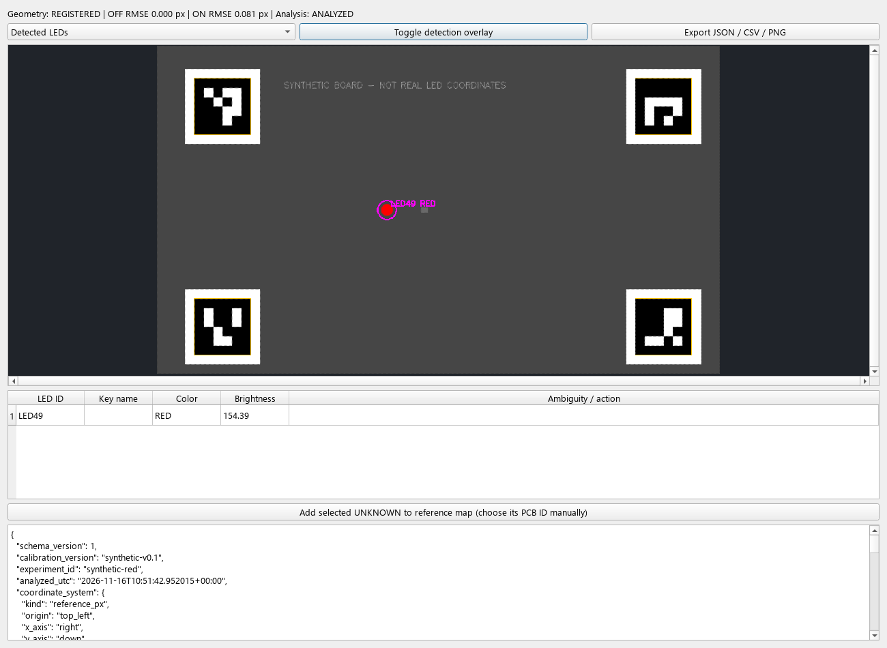

# RGB Vision v0.2 — актуальные правила анализа

Этот раздел заменяет алгоритмические описания v0.1 ниже. Реальные OFF/RED:
LED49 ON/RED; OFF/OFF: OFF. GREEN/BLUE ещё не проверены.
Подробный отчёт: [real_validation.md](real_validation.md).

CLI: --mode KNOWN_LEDS (по умолчанию) или DISCOVER; --threshold 30,
--color-threshold 25, --roi-radius 40, --min-area 6. Старый --match-radius
принимается для совместимости, но автоматического сопоставления больше нет.
KNOWN агрегирует одну ROI на LED, DISCOVER сохраняет предложения без ID.

Покрытие ROI должно быть ≥90%, центр сигнала — не дальше 0,75 радиуса.
Яркость без достаточной цветности, недоступная геометрия или пересекающиеся
ROI дают UNCERTAIN. Нет нового сигнала — OFF. Цвет определяется по новому
ореолу относительно OFF с удалённой нейтральной составляющей. Белое ядро
не голосует за цвет. Closing 5×5 объединяет разрывы, opening 3×3 удаляет шум.
Глобальный адаптивный порог теперь только диагностическое поле
legacy_global_threshold; он не подавляет локальный сигнал.
Маска ArUco и ограничения регистрации сохранены.

GUI предлагает оба режима и пороги. Виды: Original OFF/ON, ON markers,
Registered OFF/ON, Difference, Valid overlap, Color mask, Color signal,
LED ROIs, Candidates, Accepted, Rejected, Original ON annotated, Detected LEDs.
Таблица показывает status, brightness, chroma, причины; клик увеличивает ROI
и показывает её параметры. Известный LED виден даже при FAILED как UNCERTAIN.
В DISCOVER отображаются CANDIDATE/REJECTED; вручную добавляется только
неотклонённый UNKNOWN. Цветные отражения требуют проверки оператором.

Экспорт results.json schema_version=2: known_leds (все известные),
candidates (включая отклонённые), detections (ON/UNCERTAIN для KNOWN,
предложения для DISCOVER). Не трактовать все detections как доказанный свет.
CSV содержит все known_leds либо candidates выбранного режима, включая
status/chroma/rejection_reasons. JSON также хранит покрытие, пересвет,
проекции в исходные кадры и центр сигнала отдельно от координат карты.
При отказе сохраняются строки UNCERTAIN; успешных наблюдений нет.
Экспорт новых PNG включает color_mask, color_signal, led_rois, candidates,
accepted, rejected_candidates, original_on_annotated.
--overwrite удаляет устаревшие известные PNG, сохраняя посторонние файлы.

Воспроизводимый анализ с графиками:
`tools/validate_real_images.py --output build/vision/new_real_validation`.
Входы read-only, SHA-256 проверяются; каталог должен быть новым.
Без настоящих файлов подстановка синтетики не выполняется.

---

## История v0.1 (описания старого алгоритма ниже не действуют)

# Анализ фотографий OFF/ON

Сначала создать реальную карту в [калибраторе](calibration_guide.md).
Для практической проверки LED49 подготовить четыре настоящих фото с
неподвижными относительно платы ArUco: OFF, RED, GREEN, BLUE. Камера может
иметь разные допустимые ракурсы; экспозицию/баланс белого желательно сохранять.
Обеспечить резкость маркеров и отсутствие пересвета. Электрические результаты
1033/886/794 мкА не являются оптическим тестом этой программы.

## CLI

```powershell
.\.venv\Scripts\python.exe tools/analyze_images.py --calibration config/gs75_board_calibration.json --off data/off.jpg --on data/red.jpg --output build/vision/red_test --experiment-id LED49_RED
```

Аналогично выбрать green.jpg/blue.jpg и новые каталоги вывода.
Настройки: --threshold 30 (порог положительного прироста яркости),
--match-radius 20 (расстояние сопоставления в пикселях эталона), --min-area 6
(минимальная площадь). Это не миллиметры и не порог электрического тока.
Непустой output по умолчанию отклоняется; --overwrite явно разрешает
перезапись известных файлов анализа. Посторонние файлы не удаляются.

Демонстрация без настоящих снимков:

```powershell
.\.venv\Scripts\python.exe tools/analyze_images.py --calibration examples/vision/synthetic/calibration.json --off examples/vision/synthetic/off.png --on examples/vision/synthetic/red.png --output build/vision/demo_red
```

## GUI

В калибраторе Analyze Images → выбрать OFF, затем ON → параметры и ID опыта.
Окно результатов позволяет переключать Original OFF/ON, ON markers,
Registered OFF/ON, Difference, Valid overlap и Detected LEDs. Toggle detection
overlay переключает аннотации и чистый совмещённый ON. Колесо/pan доступны
и здесь. Таблица показывает LED ID, key name, цвет, яркость и неоднозначности;
выбор строки центрирует область. Ниже — статусы и численные ошибки регистрации.



Неизвестная область имеет ID UNKNOWN, а не выдуманный номер. Выбрав её,
можно нажать Add selected UNKNOWN: калибратор предложит вручную указать
PCB LED ID в найденных эталонных координатах. Это отдельное подтверждаемое
действие пользователя. Нажатие Export сохраняет JSON/CSV/PNG в выбранный
каталог с подтверждением перезаписи.

## Что делает алгоритм и когда отказывает

OFF и ON **независимо** регистрируются по уникальным ArUco ID и четырём
ориентированным углам в эталонную систему. Используются findHomography/RANSAC
и warpPerspective, а не непосредственное вычитание исходных кадров.

* REGISTERED: минимум три маркера с достаточным пространственным охватом.
* DEGRADED: два маркера, геометрия ещё допустима; каждая находка отмечается
  DEGRADED_REGISTRATION и требует внимательной ручной проверки.
* FAILED: меньше двух маркеров, недостаточные inliers, кластерные опоры,
  зеркальная/складчатая/чрезмерная геометрия, малая видимая область либо
  неприемлемая репроекция. LED ID при этом не формируются.

Порог RANSAC — 3 пикселя эталона; проверяются RMSE/max inlier error,
площадь опор и геометрия. Надёжнее использовать не менее трёх разнесённых
маркеров. Анализ ограничен общей видимой областью внутри опорных оболочек
обоих снимков; снаружи неизвестность не трактуется как «LED выключен».
Известная camera_model применяется до обнаружения маркеров; неверное
разрешение модели отклоняется. Без модели сильная дисторсия не исправляется.

На общей области из анализа исключаются метки вместе с белым полем.
Робастная линейная компенсация по фону допускает небольшие изменения
освещения (gain 0,7…1,3, offset до 35 уровней). При большем изменении
analysis_status=FAILED без детекций, даже если геометрия REGISTERED.
Небольшие локальные изменения ищутся положительной разностью и связными
областями. Порог дополнительно повышается относительно фоновых остаточных
различий. Несколько областей сохраняются все; положение сопоставляется
с ближайшим LED в пределах заданного радиуса. Близкие неоднозначные
соответствия остаются UNKNOWN с перечислением кандидатов.

Цвет определяется по приросту RGB: RED/GREEN/BLUE, MIXED либо UNDEFINED.
Белый клиппинг отмечается SATURATED_WHITE и не превращается в конкретный
цвет. Отражение вне меток тоже может выглядеть как свечение: результаты
являются оптическими кандидатами и требуют просмотра наложения.

## Выходные файлы

results.json содержит статусы обеих регистраций, матрицы, RMSE/ошибки,
параметры и все находки. results.csv: имена ON/OFF, experiment_id, UTC-время,
LED ID/key name, X/Y эталона, цвет, яркость (8-битный прирост), площадь в
эталонных пикселях, registration_status, reprojection_error_px, ambiguity_flags
и calibration_version. JSON дополнительно хранит средние RGB-приросты и
кандидатов сопоставления. Пустые key name/LED ID не подменяются догадками.

PNG: on_markers.png, registered_off.png, registered_on.png, difference.png,
valid_overlap.png и annotated.png. При отказе сохраняются диагностика,
CSV без выдуманных строк и доступные изображения; старые успешные PNG
не остаются после явной перезаписи неуспешным анализом. Код CLI 0 означает
выполненный анализ, в том числе DEGRADED; 2 — отказ/некорректный ввод.

Настоящие OFF/RED/GREEN/BLUE снимки платы с ArUco пока не анализировались.
Синтетический успех нельзя считать практической оптической верификацией.
