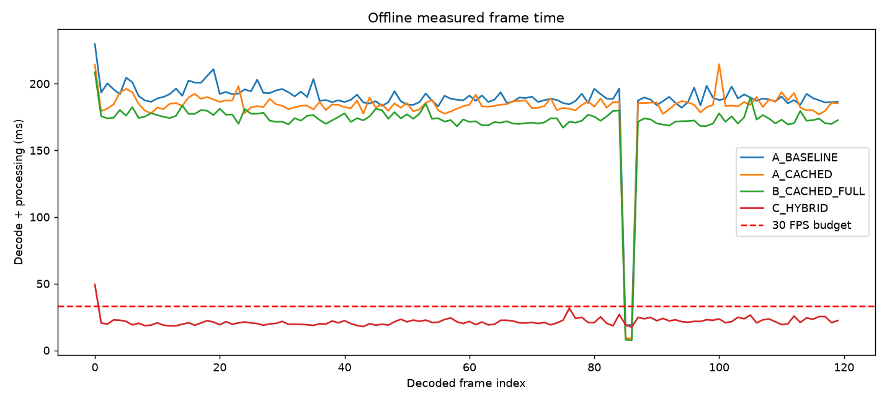
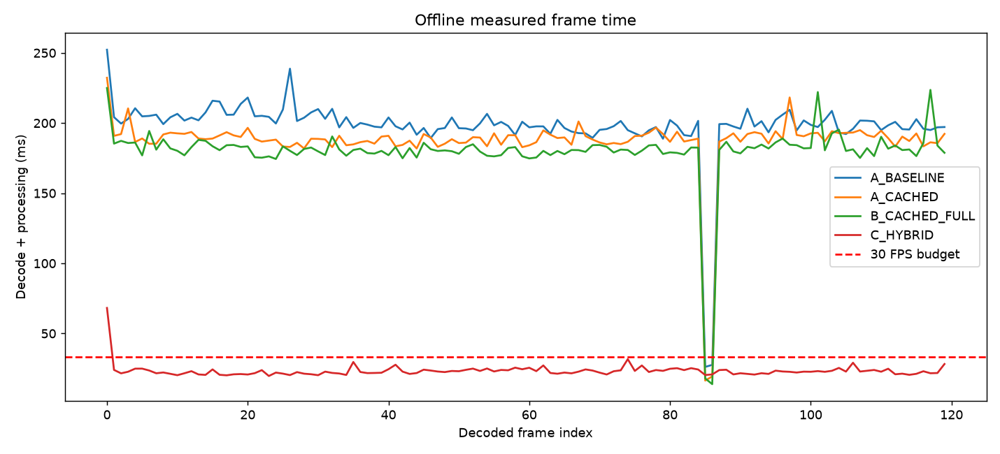
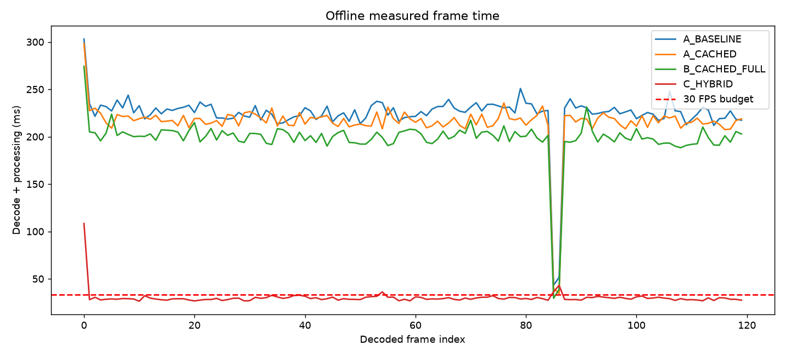
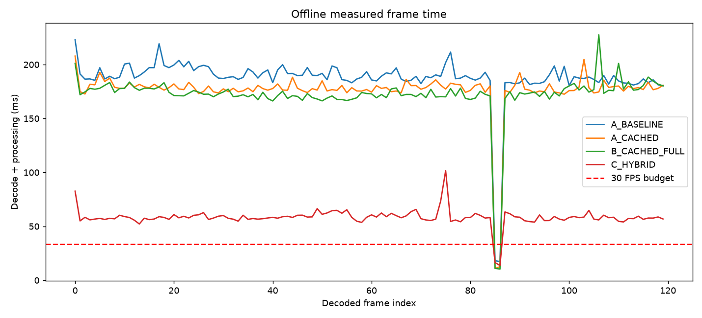
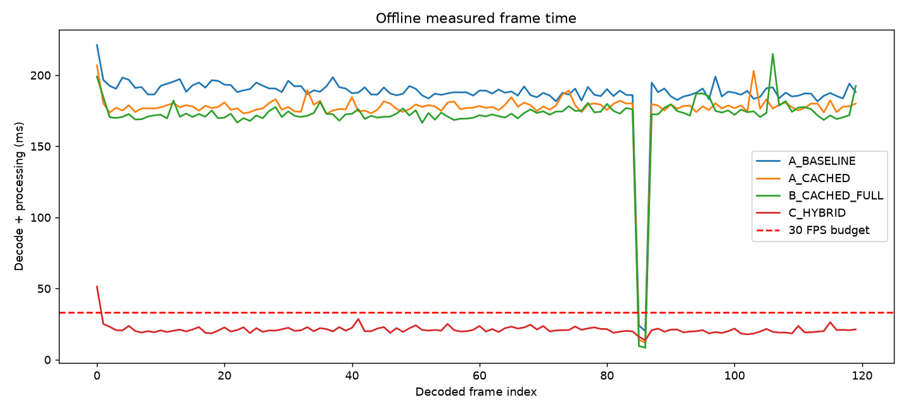
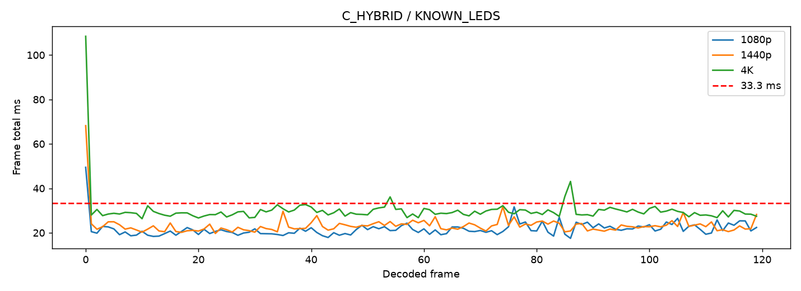
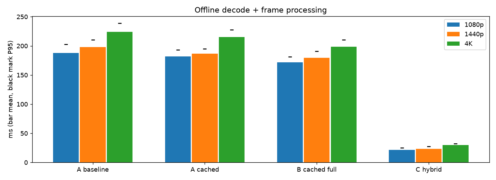

# RGB Vision v0.4-perf — фактические измерения

Пользователь подтвердил: реального видео пока нет. Ниже только синтетические MP4, не съёмка телефона.
120 кадров / 4 секунды / 30 FPS; reference grid 1200×700 при всех трёх размерах входного видео.
Это меньше реальной карты GS75 4000×2256; цифры нельзя переносить на неё без нового видеозамера.
Прогрев 3 кадра отдельным проходом, затем новое последовательное декодирование всех кадров с нуля.
Исходный baseline A повторно регистрирует OFF; A_CACHED — контроль с кэшем, B — кэш без диагностических копий.
C — уменьшенный ArUco с full-resolution refinement/fallback, coarse-фон и локальные ROI.

## 1080p

Размер входа: 1920×1080; режим KNOWN_LEDS.

| Вариант | Mean ms | P50 | P95 | P99 | Max | FPS | RSS MiB | Quality |
|---|---:|---:|---:|---:|---:|---:|---:|---|
| A_BASELINE | 187.948 | 188.932 | 202.416 | 209.939 | 229.762 | 5.321 | 268.9 | PASS |
| A_CACHED | 181.965 | 184.104 | 193.446 | 211.231 | 214.624 | 5.496 | 283.2 | PASS |
| B_CACHED_FULL | 171.611 | 173.649 | 181.227 | 188.749 | 208.648 | 5.827 | 292.4 | PASS |
| C_HYBRID | 21.628 | 20.994 | 25.327 | 30.754 | 49.451 | 46.236 | 268.4 | PASS |

OFF: 4 совмещённых наблюдения; достоверная маска 74.649%.
Отдельные расходы вне кадров: {'DIAGNOSTIC_PNG': 204.3025, 'GUI_UPDATE': 0.0, 'RESULT_WRITE': 151.0641}. OFF setup: 3086.1 ms.

### Стадии 1080p (exclusive)

#### A_BASELINE

| Стадия | Mean ms | P50 | P95 | P99 | Max |
|---|---:|---:|---:|---:|---:|
| VIDEO_DECODE | 1.6834 | 1.4250 | 1.7444 | 2.7004 | 31.2603 |
| ARUCO_DETECT | 13.1376 | 12.9394 | 15.7376 | 17.6310 | 24.0209 |
| HOMOGRAPHY | 1.1449 | 1.1159 | 1.4264 | 1.5762 | 1.6581 |
| IMAGE_RECTIFICATION | 7.0770 | 6.9171 | 8.0901 | 9.8635 | 15.2959 |
| BACKGROUND_COMPENSATION | 28.9394 | 28.9907 | 31.6409 | 36.1438 | 38.6289 |
| LED_DETECTION | 126.2083 | 127.6064 | 133.8803 | 137.4561 | 144.3088 |
| COLOR_CLASSIFICATION | 0.1357 | 0.0161 | 0.5709 | 0.7512 | 0.9236 |
| EVENT_AGGREGATION | 0.0077 | 0.0066 | 0.0165 | 0.0195 | 0.0199 |
| FRAME_TOTAL | 187.9478 | 188.9320 | 202.4156 | 209.9385 | 229.7625 |
| DIAGNOSTIC_CREATION | 4.4597 | 4.4467 | 4.8998 | 5.1430 | 5.6738 |
| DIAGNOSTIC_PNG | 0.0000 | 0.0000 | 0.0000 | 0.0000 | 0.0000 |
| GUI_UPDATE | 0.0000 | 0.0000 | 0.0000 | 0.0000 | 0.0000 |
| RESULT_WRITE | 0.0000 | 0.0000 | 0.0000 | 0.0000 | 0.0000 |

CPU: 11.91% всего ПК; decode FPS=594.02; processing FPS=5.37; wall FPS=5.32.
#### A_CACHED

| Стадия | Mean ms | P50 | P95 | P99 | Max |
|---|---:|---:|---:|---:|---:|
| VIDEO_DECODE | 1.6712 | 1.4282 | 1.6716 | 2.3273 | 29.8086 |
| ARUCO_DETECT | 8.7777 | 8.1411 | 10.6064 | 10.9090 | 10.9438 |
| HOMOGRAPHY | 0.5576 | 0.5195 | 0.7896 | 0.9539 | 0.9947 |
| IMAGE_RECTIFICATION | 4.9399 | 5.1234 | 6.3085 | 6.6857 | 7.1326 |
| BACKGROUND_COMPENSATION | 29.7011 | 29.5716 | 32.6854 | 34.1023 | 60.4611 |
| LED_DETECTION | 126.7188 | 128.3070 | 132.9320 | 136.9530 | 138.9166 |
| COLOR_CLASSIFICATION | 0.1270 | 0.0152 | 0.5369 | 0.7215 | 0.7569 |
| EVENT_AGGREGATION | 0.0086 | 0.0075 | 0.0175 | 0.0208 | 0.0215 |
| FRAME_TOTAL | 181.9647 | 184.1039 | 193.4461 | 211.2314 | 214.6235 |
| DIAGNOSTIC_CREATION | 4.4709 | 4.4491 | 4.9221 | 5.1482 | 6.2214 |
| DIAGNOSTIC_PNG | 0.0000 | 0.0000 | 0.0000 | 0.0000 | 0.0000 |
| GUI_UPDATE | 0.0000 | 0.0000 | 0.0000 | 0.0000 | 0.0000 |
| RESULT_WRITE | 0.0000 | 0.0000 | 0.0000 | 0.0000 | 0.0000 |

CPU: 9.99% всего ПК; decode FPS=598.39; processing FPS=5.55; wall FPS=5.49.
#### B_CACHED_FULL

| Стадия | Mean ms | P50 | P95 | P99 | Max |
|---|---:|---:|---:|---:|---:|
| VIDEO_DECODE | 1.5741 | 1.3312 | 1.5356 | 2.1393 | 29.0979 |
| ARUCO_DETECT | 8.3636 | 7.8154 | 10.4014 | 10.6014 | 10.8085 |
| HOMOGRAPHY | 0.5376 | 0.5167 | 0.7859 | 0.8366 | 1.1070 |
| IMAGE_RECTIFICATION | 3.9847 | 3.9968 | 5.0771 | 5.2593 | 5.2956 |
| BACKGROUND_COMPENSATION | 29.0990 | 29.4587 | 31.6591 | 33.5383 | 33.7541 |
| LED_DETECTION | 124.9205 | 126.7657 | 130.9587 | 133.3719 | 143.5536 |
| COLOR_CLASSIFICATION | 0.1269 | 0.0158 | 0.5062 | 0.7767 | 1.0036 |
| EVENT_AGGREGATION | 0.0065 | 0.0047 | 0.0141 | 0.0172 | 0.0183 |
| FRAME_TOTAL | 171.6113 | 173.6489 | 181.2273 | 188.7489 | 208.6481 |
| DIAGNOSTIC_CREATION | 0.0000 | 0.0000 | 0.0000 | 0.0000 | 0.0000 |
| DIAGNOSTIC_PNG | 0.0000 | 0.0000 | 0.0000 | 0.0000 | 0.0000 |
| GUI_UPDATE | 0.0000 | 0.0000 | 0.0000 | 0.0000 | 0.0000 |
| RESULT_WRITE | 0.0000 | 0.0000 | 0.0000 | 0.0000 | 0.0000 |

CPU: 9.34% всего ПК; decode FPS=635.29; processing FPS=5.88; wall FPS=5.83.
#### C_HYBRID

| Стадия | Mean ms | P50 | P95 | P99 | Max |
|---|---:|---:|---:|---:|---:|
| VIDEO_DECODE | 1.6027 | 1.3565 | 1.6671 | 2.6521 | 29.4016 |
| ARUCO_DETECT | 7.7468 | 7.6249 | 9.1297 | 14.6747 | 17.3925 |
| HOMOGRAPHY | 0.5367 | 0.4805 | 0.7722 | 0.9423 | 1.0479 |
| IMAGE_RECTIFICATION | 3.1293 | 3.0484 | 3.8789 | 4.2658 | 4.2945 |
| BACKGROUND_COMPENSATION | 6.5578 | 6.2912 | 9.0343 | 10.5159 | 12.4356 |
| LED_DETECTION | 1.6357 | 1.6063 | 2.0538 | 2.2988 | 2.8093 |
| COLOR_CLASSIFICATION | 0.0517 | 0.0077 | 0.1890 | 0.2835 | 0.4392 |
| EVENT_AGGREGATION | 0.0051 | 0.0039 | 0.0091 | 0.0114 | 0.0261 |
| FRAME_TOTAL | 21.6280 | 20.9936 | 25.3268 | 30.7539 | 49.4506 |
| DIAGNOSTIC_CREATION | 0.0000 | 0.0000 | 0.0000 | 0.0000 | 0.0000 |
| DIAGNOSTIC_PNG | 0.0000 | 0.0000 | 0.0000 | 0.0000 | 0.0000 |
| GUI_UPDATE | 0.0000 | 0.0000 | 0.0000 | 0.0000 | 0.0000 |
| RESULT_WRITE | 0.0000 | 0.0000 | 0.0000 | 0.0000 | 0.0000 |

CPU: 28.33% всего ПК; decode FPS=623.95; processing FPS=49.94; wall FPS=46.17.
## 1440p

Размер входа: 2560×1440; режим KNOWN_LEDS.

| Вариант | Mean ms | P50 | P95 | P99 | Max | FPS | RSS MiB | Quality |
|---|---:|---:|---:|---:|---:|---:|---:|---|
| A_BASELINE | 197.846 | 199.236 | 210.687 | 234.827 | 252.264 | 5.054 | 356.6 | PASS |
| A_CACHED | 186.934 | 188.974 | 195.026 | 216.739 | 232.277 | 5.349 | 368.9 | PASS |
| B_CACHED_FULL | 179.725 | 181.122 | 190.570 | 223.332 | 224.974 | 5.564 | 376.6 | PASS |
| C_HYBRID | 23.321 | 22.780 | 27.236 | 31.299 | 68.196 | 42.880 | 353.7 | PASS |

OFF: 4 совмещённых наблюдения; достоверная маска 74.649%.
Отдельные расходы вне кадров: {'DIAGNOSTIC_PNG': 206.6812, 'GUI_UPDATE': 0.0, 'RESULT_WRITE': 160.6577}. OFF setup: 3274.5 ms.
## 4K

Размер входа: 3840×2160; режим KNOWN_LEDS.

| Вариант | Mean ms | P50 | P95 | P99 | Max | FPS | RSS MiB | Quality |
|---|---:|---:|---:|---:|---:|---:|---:|---|
| A_BASELINE | 224.273 | 226.551 | 238.713 | 250.259 | 303.101 | 4.459 | 593.2 | PASS |
| A_CACHED | 215.115 | 217.448 | 227.550 | 234.944 | 298.315 | 4.649 | 608.4 | PASS |
| B_CACHED_FULL | 198.317 | 200.255 | 210.284 | 229.848 | 274.179 | 5.042 | 616.6 | PASS |
| C_HYBRID | 30.057 | 29.093 | 32.398 | 41.813 | 108.430 | 33.270 | 613.6 | PASS |

OFF: 4 совмещённых наблюдения; достоверная маска 74.649%.
Отдельные расходы вне кадров: {'DIAGNOSTIC_PNG': 207.2082, 'GUI_UPDATE': 0.0, 'RESULT_WRITE': 125.8781}. OFF setup: 3562.7 ms.
## DISCOVER_1080p

Размер входа: 1920×1080; режим DISCOVER.

| Вариант | Mean ms | P50 | P95 | P99 | Max | FPS | RSS MiB | Quality |
|---|---:|---:|---:|---:|---:|---:|---:|---|
| A_BASELINE | 187.354 | 188.186 | 201.338 | 217.823 | 222.876 | 5.337 | 269.3 | PASS |
| A_CACHED | 176.102 | 177.877 | 186.334 | 202.447 | 207.815 | 5.679 | 281.2 | PASS |
| B_CACHED_FULL | 171.991 | 173.316 | 183.754 | 201.071 | 227.543 | 5.814 | 288.7 | PASS |
| C_HYBRID | 58.353 | 58.152 | 64.854 | 80.890 | 101.673 | 17.137 | 265.6 | PASS |

OFF: 4 совмещённых наблюдения; достоверная маска 74.649%.
Отдельные расходы вне кадров: {'DIAGNOSTIC_PNG': 188.685, 'GUI_UPDATE': 0.0, 'RESULT_WRITE': 91.6529}. OFF setup: 3389.8 ms.
## GUI_1080p

Размер входа: 1920×1080; режим KNOWN_LEDS.

| Вариант | Mean ms | P50 | P95 | P99 | Max | FPS | RSS MiB | Quality |
|---|---:|---:|---:|---:|---:|---:|---:|---|
| A_BASELINE | 186.490 | 188.077 | 196.636 | 198.956 | 221.210 | 5.362 | 391.4 | PASS |
| A_CACHED | 175.660 | 177.737 | 184.518 | 200.469 | 206.857 | 5.693 | 401.8 | PASS |
| B_CACHED_FULL | 171.321 | 172.676 | 184.807 | 197.759 | 214.891 | 5.837 | 411.8 | PASS |
| C_HYBRID | 21.127 | 20.676 | 24.197 | 28.190 | 51.373 | 47.333 | 386.3 | PASS |

OFF: 4 совмещённых наблюдения; достоверная маска 74.649%.
Отдельные расходы вне кадров: {'DIAGNOSTIC_PNG': 198.6963, 'GUI_UPDATE': 22.6601, 'RESULT_WRITE': 123.3883}. OFF setup: 3239.4 ms.

## Вывод

На всех синтетических прогонах: 118 REGISTERED, 2 намеренно недостоверных кадра; пропусков 0, RGB ground truth без ошибок.
Для C: потерь ID относительно B нет, различия центров <0,025 reference px и локальной геометрии <0,007 px.
Временные события GREEN разорваны на две части при потере ArUco; через недостоверные кадры свечение не продолжается.
KNOWN_LEDS C проходит короткий бюджет 30 FPS в 1080p/1440p. На 4K mean >25 ms, worst >100 ms, рекомендательный запас не выполнен.
DISCOVER C: ~58 ms mean, ~65 ms P95 — 30 FPS не достигается даже на этом 1080p fixture.
Без длинного реального видео и реальной карты нельзя утверждать устойчивые 30 FPS; потоковая очередь проверена только расчётной моделью.
Рекомендация: C для известных LED, полный поиск при недостоверной ROI; B как контроль качества и для сложного DISCOVER.
Автоматический OFF: медиана по надёжным наблюдениям, маска частоты наблюдений; не копия первого кадра.
Обновление фона требует гарантированного OFF и запрещено при последнем подтверждённом свете.
RSS — максимум наблюдений процесса каждые 10 ms, включает GUI/модели, не точный пик аллокатора и не изолированный subprocess peak.
FRAME_TOTAL включает decode/events; стадии exclusive, нераспределённая служебная работа остаётся в FRAME_TOTAL.
Матрицы камеры для benchmark пока не поддержаны: camera_model должен быть null; старый фотоанализ сохранён.

