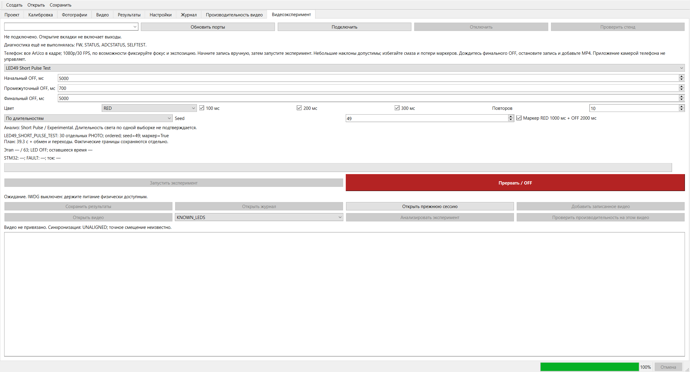
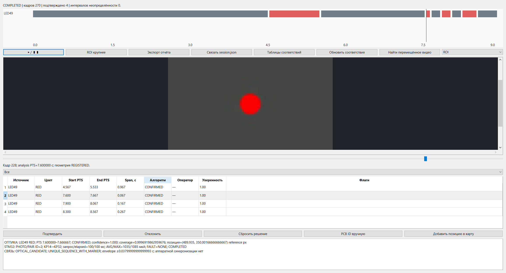
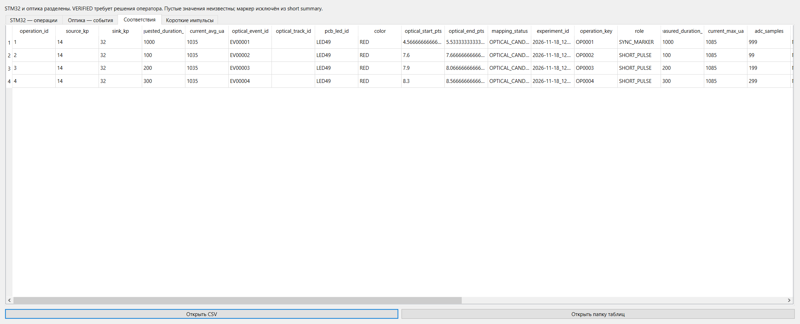
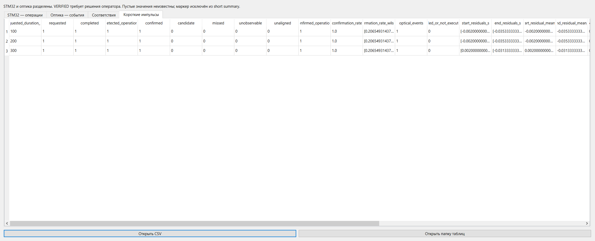

# RGB Vision v0.4.4 — короткие импульсы и видео через GUI

Запуск: **Start_RGB_Vision.bat**. Терминал и ручные CDC-команды для этого
сценария не нужны. Прошивка остаётся **0.1.2**. Программа не запускает
эксперимент при подключении, выборе preset, открытии проекта или видео.
Съёмку телефона оператор начинает и заканчивает самостоятельно.

## Первое аппаратное испытание

18.11.2026 оператор выполнил первую настоящую серию RED 100/200/300 мс ×10:
все 30 PHOTO завершены, ток≈1033 мкА. [Разбор реального видео v0.4.5](short_pulse_v045/report.md).
Это не приёмка аварийных сценариев новой серии или всех 40 контактов.
Старые успешные аппаратные результаты LED49/PHOTO/OFF сохранены отдельно в
[hardware_validation.md](../hardware_validation.md). Новые примеры ниже
получены имитатором и синтетическим видео.

1. При снятом питании проверить известную LED49, подключение платы, **U13 OPEN**,
   **R1 = 2700 Ом**. Оставить возможность быстро снять питание: **IWDG отсутствует**.
2. Открыть или создать проект исследования, загрузить и сохранить проверенную
   калибровку. Для KNOWN_LEDS нужна размеченная LED49; DISCOVER использует
   ArUco/координатную основу без заранее заданных позиций LED.
3. Открыть **«Видеоэксперимент»**, выбрать COM через **«Обновить порты»** или
   ввести фактический порт, нажать **«Подключить»**. Закрыть другие программы,
   занимающие этот порт. Подключение выполняет только диагностику.
4. Убедиться в FW 0.1.2 / PHOTO_LED49, DISARMED, FAULT=NONE, EN=0/0,
   ADC VALID=1/HAS_SAMPLE=1/AGE_MS≤5/ERRORS=OVR_COUNT=0 и SELFTEST=PASS.
   **«Проверить стенд»** повторяет проверки без включения выхода.
5. В списке сценариев выбрать **LED49 Short Pulse Test**. Для первой короткой
   проверки рекомендуется один повтор каждой длительности; штатное значение
   **10 повторов** предназначено для последующей полной серии.
6. Оставить RED, 100/200/300 мс, OFF-паузу 700 мс, начальный и финальный OFF
   по 5000 мс. При необходимости включить **«Маркер RED 1000 мс + OFF 2000 мс»**.
   Маркер позволяет отличить начало серии, но сам не входит в short summary.
7. Начать запись телефона: 1080p/30 FPS, все ArUco в кадре, по возможности
   зафиксировать фокус и экспозицию. Избегать смаза/пересвета. 60 FPS — отдельный
   будущий аппаратный опыт; программная обработка сохраняет реальные PTS.
8. Нажать **«Запустить эксперимент»**, затем явно отметить пять условий в
   диалоге и нажать **«Подтвердить и начать»**. Отмена диалога ничего не включает.
9. Следить за этапом, током, FAULT и EN. При необходимости нажать красную
   **«Прервать / OFF»**. При неподтверждённом отключении физически снять питание.
   После ошибки серия сама не возобновляется.
10. Дождаться COMPLETED и подтверждения финального OFF/EN=0, остановить запись.
    Сохранить журнал. Для полной статистики отдельно выполнить серию с ×10;
    проверить новый OFF в середине короткой серии отдельным запуском.

Скриншот интерфейса не доказывает аппаратное испытание. На нём показан
план 30 коротких PHOTO и маркер; запуск без подключения/подтверждения недоступен.

## Параметры и ограничения

| Параметр | По умолчанию | Допустимые настройки |
|---|---|---|
| Сценарий | LED49 RGB 5 seconds при открытии | прежний RGB или LED49 Short Pulse Test |
| Цвет короткой серии | RED | RED / GREEN / BLUE известной LED49 |
| Длительности | 100, 200, 300 мс | любая непустая комбинация этих трёх |
| Повторы каждой длительности | 10 | 1…30 |
| Начальный / финальный OFF | 5000 / 5000 мс | 100…60000 мс; для Auto OFF оставлять ≥2 с |
| Промежуточный OFF | 700 мс | 100…60000 мс |
| Порядок | По длительностям | Перемешать с сохранённым seed |
| Seed | 49 | 0…2147483647; используется локальный RNG |
| Маркер | выключен | RED 1000 мс, затем отдельный OFF 2000 мс |
| Анализ короткой серии | Short Pulse / Experimental | далее можно пересчитать temporal-параметры |

Штатный план без маркера — **36,3 с**, с маркером — **39,3 с**, плюс
реальное время USB, проверок и переключений. После последнего короткого PHOTO
идёт финальный OFF; дополнительных 700 мс поверх него нет. Номинальные границы
не выдаются за фактические. Маркер всегда RED, даже при другом цвете серии.

Выполняются только `PHOTO LED49 <COLOR> <DURATION_MS>` и собственный ARM
перед каждым PHOTO. PAIR для этого эксперимента не используется. Нельзя
подменить validated preset произвольными контактами или PHOTO длительностью
вне выбранных 100/200/300 мс и отдельного маркера.

Один поток владеет CDC. Протокол проверяет ACK по MODE/LED/COLOR/SRC/SNK/
DURATION/ID, DONE по ID/режиму/цвету/TIMEOUT/FAULT/samples/току/elapsed.
CURRENT и ADC опрашиваются примерно каждые 20 мс плюс обмен; FW продолжает
защищать независимо от частоты host-проверок. После каждого PHOTO проверяются
OFF, STATUS DISARMED/EN0/FAULT=NONE, ADC и CURRENT. Только затем возможен
следующий импульс. OFF-паузы отсчитываются после подтверждённого отключения.

При FAULT, плохом ADC, потере USB, неверном ACK/DONE, отсутствии DONE,
аномальном токе или неподтверждённом OFF серия прекращается, сохраняет
частичный журнал и весь план. Повторов команды, автоматического CLEARFAULT
и возобновления после аварии нет. Каждый новый запуск требует подтверждения.
OFF/STATUS — подтверждение состояния протокола, не физическое измерение EN.

## Эксперимент → видео → анализ → шкала → экспорт

1. После завершения нажать **«Добавить записанное видео»**, выбрать MP4 в
   стандартном диалоге Windows. Можно также загрузить **«Открыть прежнюю сессию»**.
   Большой файл остаётся внешней ссылкой, не копируется в журнал.
2. Выбрать KNOWN_LEDS или DISCOVER рядом с кнопкой анализа.
3. Нажать **«Анализировать эксперимент»**. Связанный проект и калибровка
   открываются автоматически. Если привязки нет, GUI предлагает выбрать проект
   или карту, при необходимости корень данных с эталоном. Исправление ошибки
   загрузки не превращается в бесконечное повторное открытие диалога.
4. Вкладка «Видео» получает настоящий выбранный MP4. Для короткого сценария
   автоматически применяется Short Pulse / Experimental, Auto OFF [0,2) с.
   Первые две секунды должны показывать выключенную плату; при другом монтаже
   сначала скорректировать OFF-интервал во вкладке «Видео».
5. Все кадры обрабатываются прежним C_HYBRID/TemporalDetector; никакие времена
   из session.json не передаются детектору. После анализа строится соответствие
   с электрическим журналом. Во время анализа работают прогресс/PTS/ETA/Cancel.
6. Откроется окно результатов. **Полная временная шкала расположена сверху**:
   цветные подтверждённые события, полупрозрачные кандидаты, достоверный OFF
   и штрихованные неопределённые интервалы. По умолчанию связанная серия
   показывает все события, а не только CONFIRMED.
7. Нажать событие в таблице или позицию на шкале. Плеер переходит к фактическому
   PTS/кадру. **«ROI крупнее»** и слой **ROI** увеличивают позицию. Внизу отдельно
   показаны оптика и STM32: ID, SOURCE/SINK, requested/elapsed, AVG/MAX, FAULT.
   При отсутствии однозначной связи ток и контакты не выдумываются.
8. **«Таблицы соответствий»** открывают четыре вкладки CSV. **«Открыть CSV»**
   передаёт текущий файл приложению Windows, **«Открыть папку таблиц»** — папку.
   Столбцы можно прокручивать и переставлять в просмотрщике.
9. Проверить кандидаты вручную: **«Подтвердить»**, **«Отклонить»**,
   **«Сбросить решение»**. Для неизвестного источника PCB ID вводится только
   кнопкой **«PCB ID вручную»** по проверенной шелкографии. Прежние исходные
   события и прошлые CSV сохраняются. **«Обновить соответствия»** создаёт
   ещё один снимок таблиц с текущими решениями.
10. **«Экспорт отчёта»** выбирает каталог и создаёт новую копию всего пакета
    анализа, включая raw, timeline, ручную историю и все снимки соответствий.
    Видео не копируется. Электрический журнал сохранять отдельно кнопкой
    **«Сохранить результаты»** во вкладке эксперимента; это полноценный журнал
    STM32 со всеми событиями, а не только нормализованная таблица.

**«Проверить производительность на этом видео»** остаётся отдельным действием
Benchmark; для получения событий вместо него используется анализ эксперимента.
Повторный temporal-профиль может использовать совместимые сохранённые
наблюдения, не запуская повторно OpenCV. Старые результаты не перезаписываются.

## Как читать статистику

`requested` включает весь план, даже неисполненную часть прерванной серии.
`completed` — успешные электрические операции. Число оптических событий может
быть больше числа операций: одна операция может осветить несколько позиций.
Маркер исключён из short summary и отмечен ролью SYNC_MARKER в остальных CSV.

MISSED означает отсутствие события при достоверном **выборочном** OFF в
целевом ROI и однозначной привязке времени. Это не доказательство отсутствия
света между экспозициями. UNOBSERVABLE означает недостаточную геометрию,
покрытие, пропущенные кадры или неопределённую фотометрию/экспозицию.
Для DISCOVER отсутствие кандидата само по себе не подтверждает OFF.
При неопределённом сдвиге результат UNALIGNED/AMBIGUOUS, не MISSED.

Лишние события перечисляются отдельно; они не объявляются ложными автоматически.
Число подтверждённо отклонённых оператором лишних событий отделено от ещё не
проверенных. Ошибки границ в summary — остатки относительно эмпирического
USB/video соответствия, **не измеренная физическая ошибка фронтов**.

Для каждой длительности сохраняются confidence, сигнал/цветность,
распределения start/end residuals и Wilson95 для доли подтверждений.
10/10 имеют нижнюю границу Wilson95 около 72,25%, а не доказывают 100%
надёжность. `series_minimum_all_confirmed_ms` требует минимум десять операций
каждой проверяемой длительности, все подтверждённые и отсутствие лишних
событий. Это условный результат серии; общая физическая минимальная надёжная
длительность остаётся неизвестной до реальных повторных испытаний.

## Примеры, ограничения и следующий шаг

[Полная имитация ×10 с маркером](examples/v044_simulated/session.json) ·
[Mapping CSV](examples/v044_simulated/electrical_optical_mapping.csv) ·
[Short summary](examples/v044_simulated/short_pulse_summary.csv) ·
[Прерванная серия](examples/v044_aborted_simulated/session.json).
Числовой пример имеет shuffled order / seed=173; скриншот плана показывает
ordered / seed=49. Сквозная GUI-проверка использует по одному импульсу каждой
длительности и маркер. Все эти материалы явно синтетические, не протоколы
испытания настоящей RGB-платы.

Принята штатная RED-серия ×10 без маркера; независимый анализ даёт 29 CONFIRMED
и один CANDIDATE, с частичной потерей ROI. Не испытаны на железе: маркер,
прерывание именно новой серии, аварии ADC/USB в этом GUI-сценарии, другие
цвета короткой серии и физическая точность токов/PTS. Дрейф часов не
калиброван, экспозиция и rolling shutter не измерены. IWDG не добавлен.
Массовый scan 1560 направленных пар не запускался; PHOTO остаётся LED49-only.
Подготовлен только read-only интерфейс будущего PAIR с прежним пределом
10…300 мс и без ослабления защит.

Перед 40-контактным исследованием нужны независимые ограничения тока,
полное покрытие платы/ArUco, операторская идентификация шелкографии,
реальная серия коротких импульсов и проверка наблюдаемости камеры.
Для переноса сохранять проект, калибровку/эталон, каталог электрической
сессии, экспорт анализа и исходный MP4. Большие медиа в Git не включаются.
