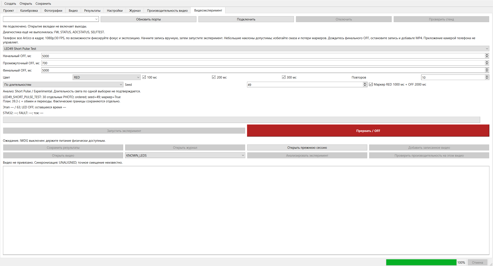
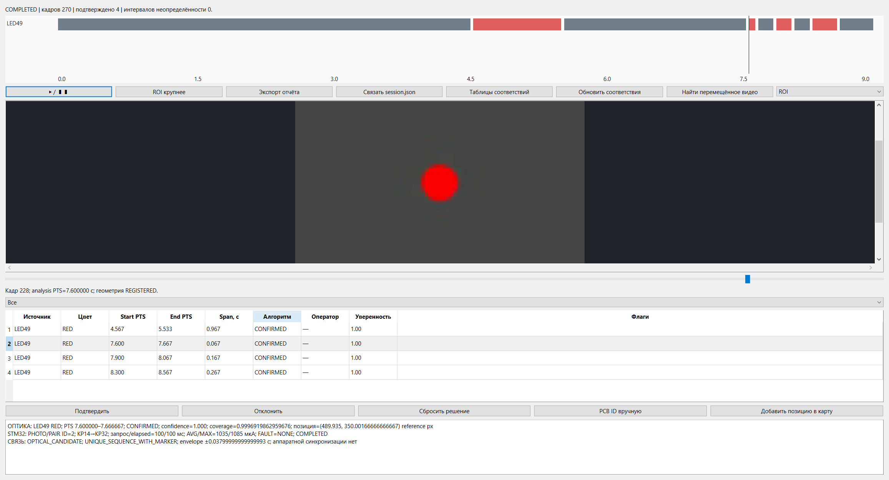
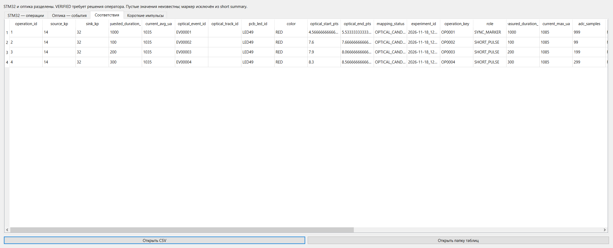
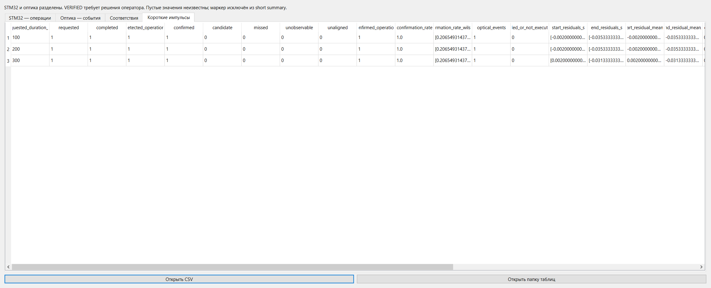

# v0.4.4 — программная приёмка, 18 ноября 2026

Исходная версия cf00ccb (v0.4.3). Прошивка STM32 не менялась, реальный COM
не открывался, физический стенд агент не запускал. Ниже **имитатор и синтетика**.
Настоящий MP4 v0.4.3 содержит длинные RGB-включения и не заменяет реального
короткоимпульсного испытания. Его числовая temporal-регрессия сохранена.

## Проверенная новая функциональность

- Два bounded сценария в существующей вкладке; LED49 Short Pulse Test с
  100/200/300 мс ×10, OFF 700 мс, initial/final OFF 5000 мс.
- Воспроизводимое shuffled seed; отдельный RED-маркер 1000 мс + OFF 2000 мс.
- Отдельный ARM и валидированный PHOTO для каждой операции; приоритетный OFF,
  контроль CURRENT/ADC и подтверждение отключения перед продолжением.
- Ошибки ADC/FAULT/USB/ACK/DONE/тока/samples/elapsed/OFF останавливают серию,
  сохраняют частичный журнал и не выполняют повторный ARM/PHOTO после аварии.
- Прямой GUI-путь от импорта MP4 к Short-анализу, шкале и четырём CSV,
  автоматическая/отсутствующая привязка проекта и карты.
- Независимые optical events; затем уникальный post-hoc matcher, неоднозначность,
  repeated pairs, один-ко-многим, UNKNOWN/MISSED/UNOBSERVABLE и ручной VERIFIED.
- Снимки соответствий и операторская история не переписывают автоматические
  события. Экспорт и повтор через raw cache остаются работоспособными.

## Обычный Windows Qt

[Машиночитаемый протокол](gui_proof.json). Backend windows, errors=[], **360
Qt timer ticks** во время анализа. Имитатор выполнил маркер и по одному
100/200/300 мс PHOTO. Закодированный синтетический MP4 **270/270 кадров**,
четыре CONFIRMED события, четыре mapping-строки, ESTIMATED_NOT_HARDWARE_SYNC.
Маркер исключён из short summary. Итоговый просмотр: выбранный кадр **228**,
слой ROI, ток 1035/1085 мкА из имитатора и KP14→KP32, не физическое измерение.
После быстрой смены события и ROI сохраняется выбранный кадр; это отдельная
GUI-регрессия. Четыре вкладки CSV открываются, экспорт сохраняет весь пакет.

## Числовая серия ×10 и короткоимпульсная проверка

[Полный журнал](../examples/v044_simulated/session.json), simulation=true;
shuffled, seed=173. 31 операция: маркер + 30 коротких. Каждый запрос имеет
собственный MCU ID, ARM, TIMEOUT/DONE и подтверждённый OFF. На идеальных
синтетических наблюдениях 30 FPS — по **10/10 CONFIRMED** для 100/200/300 мс,
нет лишних событий, MISSED и UNOBSERVABLE. Токи заданы имитатором, не получены
от реальной платы. Файлы CSV/JSON доступны рядом с журналом.

Условный `series_minimum_all_confirmed_ms=100` описывает только эту синтетику.
`minimum_reliable_duration_ms=null`. Даже 10/10 имеют Wilson95 lower≈0,7225.
Маркер не учитывается при выборе short minimum и расчёте short summary.

Тесты дополнительно проверяют четыре фазы выборки на **30 и 60 FPS** для
100/200/300 мс; видимость идеальна, длительность света не приравнивается
наблюдаемому span. Сценарии включают потерянные кадры, настоящий пропуск
события при sampled OFF, отсутствие геометрии, неопределённую экспозицию,
лишний кандидат, неоднозначную периодическую последовательность и два
оптических источника на одну электрическую операцию. Оптические времена не
подгоняются по журналу; исходные события проверяются на неизменность.

[Пример ABORTED](../examples/v044_aborted_simulated/session.json): три PHOTO
завершены, четвёртый прерван OFF, дальнейших PHOTO нет, полный план сохранён.

## Проверки и оставшаяся аппаратная приёмка

**Финальный полный прогон: 163 Python-теста PASS за 186,257 с; две C-регрессии
PASS за 0,21 с.** Сохранены все прежние 145 тестов; добавлены 18 проверок.
Включены старые фотоанализ/калибратор/Automatic OFF/Benchmark/видеоэксперимент,
проект/GUI Cancel и записанный real-trace. Новые проверки используют только
внедрённый CDC и синтетические наблюдения/MP4. Ожидаемые ошибки загрузки
в отрицательных тестах логируются, но сами тесты завершаются PASS.
[Числовой итог](test_results.json).

Все **1239** исходных firmware/data/RGB_Vision/results/пользовательской карты
и docs/images сохранили SHA-256. Прошивка не менялась. Прежние посторонние
изменения results/off_test_100ms.json, RGB_Vision/, config/gs75_board_calibration.json
и docs/images/ сохраняются вне коммита. Ссылки новых руководств проверены.

Не приняты на железе: новая серия ×10, её OFF/маркер и аварийные остановки;
короткие импульсы/экспозиция телефона; электрическая/оптическая синхронизация;
новые направления 40-контактного шлейфа. Не реализованы аппаратная
синхронизация, калиброванный drift, IWDG и массовый PAIR scan. Следующее
аппаратное испытание выполняет оператор по [инструкции](../short_pulse_experiment.md).
