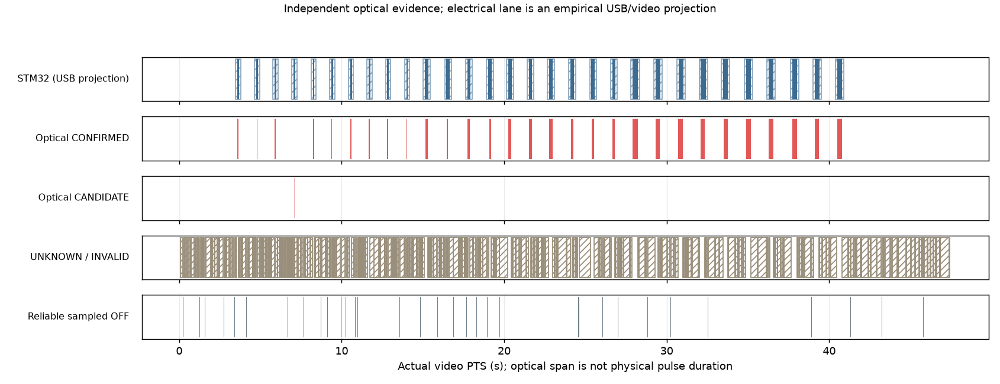
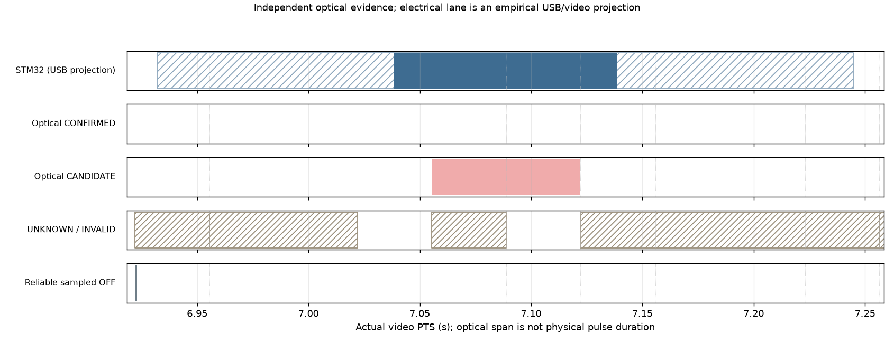
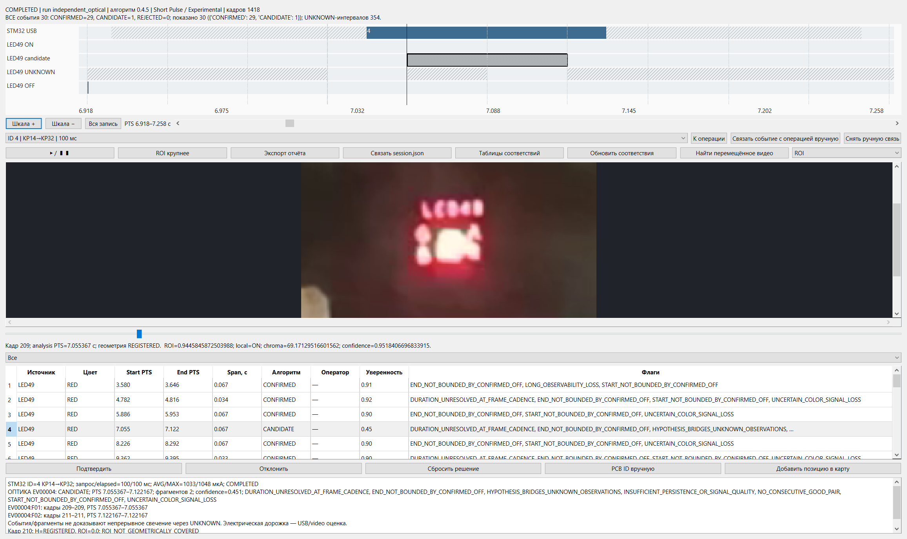
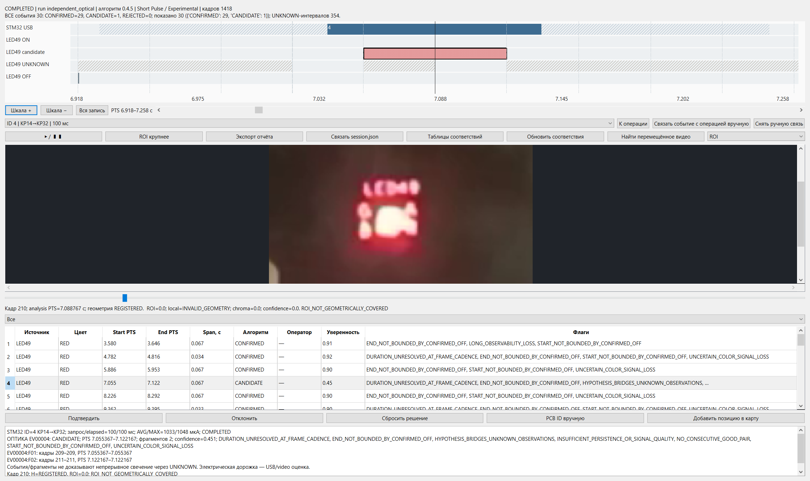

# RGB Vision v0.4.5 — реальный короткоимпульсный опыт LED49

Разбор выполнен 18.11.2026. Исходная версия 5799a53 (v0.4.4).
**Независимо восстановлены 30 оптических событий: 29 CONFIRMED и один
CANDIDATE. Связаны все 30 электрических операций.** № 4 остаётся кандидатом;
30/30 связей не означает 30 непрерывных, полностью наблюдаемых вспышек.
У всех событий `duration_confirmed=false`. Агент не открывал реальный COM,
не отправлял команды стенду и не менял прошивку.

## Источники и неизменность

Настоящий опыт оператора `2026-11-18_133313_LED49_RGB_0c4ca511de05`:
COM19, FW 0.1.2, simulation=false, LED49 RED KP14→KP32; 100/200/300 мс
по десять повторов, OFF 700 мс, без синхромаркера. Все 30 PHOTO —
COMPLETED/TIMEOUT/FAULT=NONE. Средние AVG по длительностям:
1033,0 / 1033,2 / 1033,5 мкА, ADC samples 99 / 199 / 299.
Это данные предоставленного аппаратного журнала, не симулятора.

Видео `data/VID_20261118_163314.mp4`: **1418 кадров**, H.264,
29,918003 FPS, контейнер **47,465811 с**.
SHA-256: `28cb85fb99c0bdb745956581862c9f94e867c72bcbd84d4e5ce97ad7c5554ebf`.
Проверено реальным декодированием: все 1418 PTS совпадают с raw, SHA совпадает.
[Протокол совместимости](raw_compatibility.json).

Исходный Short-анализ: `RGB_Vision/results/vision/sessions/`
`video_events_a4613f83b4f740b48f297b48ed6d514e`, исходный bundle
`correspondence_18a79b7c59954aa59e7dcef1ba8510fa`.
Сохранённый пользовательский экспорт в data/ совпадает с этим анализом.
Кэш более раннего Reliable-анализа `video_events_c7cbfbbc4a1c4a5f9694ca5b6b881c4c`
имеет побайтно тот же raw: различия появились после CV, во временном фильтре.

Пересчитаны TemporalDetector и matcher по совместимым компактным результатам.
Повторный дорогостоящий OpenCV/ArUco/LED-анализ не выполнялся. Исходные MP4,
журнал, старые CSV/кэши и пользовательские файлы сохранили контрольные суммы.

## До и после: разделение двух исправлений

| Обработка | Оптических записей | CONFIRMED | CANDIDATE | Связанных операций | UNOBSERVABLE |
|---|---:|---:|---:|---:|---:|
| Сохранённая v0.4.4 |37|31|6|22|8|
| Прежние события, только новый matcher |37|31|6|30|0|
| Новый независимый temporal, затем новый matcher |30|29|1|30|0|

Промежуточная проверка сохраняет все 37 записей и их confidence. Новый matcher
может связать несколько фрагментов одного LED с одной операцией, а не требует
отдельно от каждого фрагмента полной длительности PHOTO. При этом сохранена
связь одной операции с несколькими различными оптическими позициями.

Число CONFIRMED 31→29 не является потерей двух вспышек: прежние записи дважды
считали подтверждённые части операций № 22 и № 27. В новом результате все
**169 исходных ON-наблюдений** присутствуют ровно один раз. Ни один
INVALID_GEOMETRY/UNCERTAIN не был повышен до достоверного ON.

В исходном mapping было 15 несопоставленных оптических записей; это фрагменты,
а не автоматически ложные LED. Теперь лишних несопоставленных событий нет.
Физический false-positive rate без независимой сплошной ручной разметки не
установлен; число 0 относится к лишним записям и проверенным отрицательным
сценариям, не является доказательством идеального детектора.

## Первопричины

Short-профиль имел `max_gap_s=.050`. Один недостоверный кадр при 29,92 FPS
даёт около **.067 с между соседними ON**, поэтому активная гипотеза закрывалась
до следующего хорошего наблюдения. Семь операций распались на две части:
№ 4, 12, 13, 16, 18, 22, 27. У прежних 37 событий 36 окончаний имели
LONG_OBSERVABILITY_LOSS и только одно — CONFIRMED_OFF.

У № 14 разделения нет: два недостоверных начальных ROI оставили только
100,378 мс наблюдаемого span при запросе 200 мс. Matcher v0.4.4 требовал
`abs(span-request) ≤ max(2.5/FPS, .2*request)`, здесь **83,56 мс**.
Все фрагменты восьми несвязанных операций не проходили этот gate.
Проверки каждого фрагмента и точные величины есть в [operation_diagnostics.csv](operation_diagnostics.csv).
Общее старое ограничение на несколько событий одного entity тоже снято
во втором проходе; оно не было непосредственной причиной всех этих восьми
отказов — их span уже не проходил первичный фильтр.

| Операция | Недостоверные кадры внутри/в начале сигнала | Старая запись | Новый результат |
|---:|---|---|---|
|4|210: недостаточное покрытие ROI|два однокадровых CANDIDATE|один CANDIDATE, два фрагмента209/211|
|12|492; далее потеря хвоста494/495|CONFIRMED + CANDIDATE, слишком короткие spans|CONFIRMED, два фрагмента; конец цензурирован|
|13|530; также начальный528|CANDIDATE + CONFIRMED|CONFIRMED, два фрагмента|
|14|567/568 в начале|один CONFIRMED, span меньше запроса на99,62мс|тот же укороченный CONFIRMED, частичная связь|
|16|646|CONFIRMED + CANDIDATE|CONFIRMED, два фрагмента|
|18|723|CONFIRMED + CANDIDATE|CONFIRMED, два фрагмента|
|22|880|два CONFIRMED|один CONFIRMED, два фрагмента|
|27|1085|два CONFIRMED|один CONFIRMED, два фрагмента|

Это главным образом локальное покрытие ROI после robust-гомографии, а не
полная потеря всех ArUco. Gate покрытия 90% не ослаблялся. Например, в кадре
492 есть цветовой сигнал, но покрытие≈0,89644; он остаётся недостоверным.

## Новая временная политика и matcher

Short: `max_gap_s=.090`, `min_on_s=.020`, `min_off_s=.012`, min_samples=2,
**min_consecutive_good_samples=2**. Reliable сохранил прежние значения.
Объединение ограничено фактическим PTS, цветом/entity и отсутствием надёжного OFF.
Один достоверный OFF — жёсткий барьер. Длинная потеря геометрии разделяет события.
Короткий UNKNOWN сохраняет только гипотезу продолжения с явным разрывом.

Два изолированных хороших наблюдения через UNKNOWN теперь могут образовать
общий CANDIDATE, но не получают CONFIRMED без хорошей пары подряд.
Так классифицирована операция № 4: кадры 209/211, кадр 210 INVALID, confidence≈0,451.
Флаги NO_CONSECUTIVE_GOOD_PAIR, HYPOTHESIS_BRIDGES_UNKNOWN_OBSERVATIONS и
неограниченные физические границы сохраняются. Журнал STM32 не повышает статус.

Matcher сначала оценивает единственную шкалу по минимум трём CONFIRMED
span-compatible опорам; здесь их 27. Затем отдельно связывает совместимые
частичные события в пределах окон с учётом неопределённости. Фрагменты не
склеиваются matcher-ом, не меняют исходные confidence и не калибруют часы
задним числом. Конкурирующие окна возвращают неоднозначность, ближайшее
автоматически не выбирается. Проверены также два оптических источника одной
операции и повторяющиеся импульсы одной пары.

Теперь окончания: 22 UNCERTAIN_COLOR_SIGNAL_LOSS, 5 CONFIRMED_OFF,
3 LONG_OBSERVABILITY_LOSS. Это классификация окончания цветовой гипотезы;
22 недостоверные потери цвета не объявляются физическим OFF.

## Все 30 операций

Start/End ниже — первый/последний достоверный ON PTS; span не равен физической
длительности и не доказывает непрерывность. Длительности команд — данные STM32.
Полные TX/ACK/DONE, геометрия, OFF/ROI, RGB, confidence, причины и результаты
обоих этапов: [операционная CSV](operation_diagnostics.csv),
[покадровая CSV](operation_frame_observations.csv), [JSON](diagnostic_summary.json).

| ID | Запрос, мс | Связь до | Start PTS, с | End PTS, с | Span, с | Статус после | Фрагментов |
|---:|---:|---|---:|---:|---:|---|---:|
|1|100|да|3.579544|3.646389|0.066844|CONFIRMED|1|
|2|100|да|4.782367|4.816156|0.033789|CONFIRMED|1|
|3|100|да|5.886033|5.952700|0.066667|CONFIRMED|1|
|4|100|нет|7.055367|7.122167|0.066800|CANDIDATE|2|
|5|100|да|8.225756|8.292422|0.066667|CONFIRMED|1|
|6|100|да|9.361833|9.395167|0.033333|CONFIRMED|1|
|7|100|да|10.532256|10.598744|0.066489|CONFIRMED|1|
|8|100|да|11.668244|11.734911|0.066667|CONFIRMED|1|
|9|100|да|12.804400|12.871822|0.067422|CONFIRMED|1|
|10|100|да|13.974644|14.008067|0.033422|CONFIRMED|1|
|11|200|да|15.143956|15.311611|0.167656|CONFIRMED|1|
|12|200|нет|16.447689|16.548611|0.100922|CONFIRMED|2|
|13|200|нет|17.751300|17.885678|0.134378|CONFIRMED|2|
|14|200|нет|19.088411|19.188789|0.100378|CONFIRMED|1|
|15|200|да|20.258656|20.425389|0.166733|CONFIRMED|1|
|16|200|нет|21.528522|21.695567|0.167044|CONFIRMED|2|
|17|200|да|22.765033|22.965944|0.200911|CONFIRMED|1|
|18|200|нет|24.101944|24.269611|0.167667|CONFIRMED|2|
|19|200|да|25.372433|25.539478|0.167044|CONFIRMED|1|
|20|200|да|26.642656|26.809322|0.166667|CONFIRMED|1|
|21|300|да|27.912900|28.213422|0.300522|CONFIRMED|1|
|22|300|нет|29.316700|29.584278|0.267578|CONFIRMED|2|
|23|300|да|30.720211|30.987789|0.267578|CONFIRMED|1|
|24|300|да|32.090522|32.358178|0.267656|CONFIRMED|1|
|25|300|да|33.494256|33.761833|0.267578|CONFIRMED|1|
|26|300|да|34.898367|35.165489|0.267122|CONFIRMED|1|
|27|300|нет|36.269067|36.569589|0.300522|CONFIRMED|2|
|28|300|да|37.739378|38.006978|0.267600|CONFIRMED|1|
|29|300|да|39.109689|39.377356|0.267667|CONFIRMED|1|
|30|300|да|40.480044|40.781033|0.300989|CONFIRMED|1|

Связаны все восемь ранее несопоставленных операций. Семь имеют достаточно
оптических наблюдений для CONFIRMED; № 4 остаётся кандидатом. Верификаций
оператора в этих автоматических результатах нет: mapping_status остаётся
OPTICAL_CANDIDATE, тогда как optical_status отдельно содержит29 CONFIRMED/1 CANDIDATE.

## UNKNOWN по причинам

| Причина | Уникальных кадров | Интервалов по причине |
|---|---:|---:|
|Полная потеря/недостаток ArUco|0|0|
|Неудовлетворительная гомография|5|5|
|Недостаточное покрытие OFF/локального ROI|132|113|
|Низкий/отсутствующий цветовой сигнал|922|237|
|Неоднозначность цвета|0|0|
|Разрыв временной непрерывности|7|7|
|Иные|0|0|

Всего состояния: ON 169, OFF 190, UNCERTAIN 922, INVALID_GEOMETRY 137.
1059 уникальных недостоверных кадров, 354 интервала по state. Причинные
категории не складываются: TEMPORAL_CONTINUITY перекрывается с ROI, а один
общий INVALID-интервал может менять причину между ROI и H. Интервалы по
причине определены как непрерывные последовательности frame_index для entity.
RAW-причины не теряются. LOW_COLOR_SIGNAL при ахроматическом изменении яркости
не считается доказательством отсутствия света. Статический OFF покрывает LED
достаточно; 132 кадра относятся к текущему локальному ROI, не к отказу Auto OFF.

Достоверный sampled OFF: **190 кадров в 161 интервале**, до и после одинаково.
Операционный UNOBSERVABLE уменьшился до 0, потому что у каждой операции найдена
положительная оптическая информация; это не отменяет 1059 недостоверных кадров.

## Шкалы времени и остатки

`host_ACK_relative_s = video_ON_PTS_s + 1.836600`.
Для TX: `video_ON_PTS_s = host_TX_relative_s - 1.810167` — соответствует
предварительной диагностической оценке около−1,81с. Разный знак/значение
объясняются направлением преобразования и TX против ACK.
Observed envelope≈±0,106391с включает разброс и USB/frame brackets;
он **не ограничивает всю физическую задержку**. UTC не использован,
аппаратной синхронизации и подгонки дрейфа нет.

Остатки всех 30 связей относительно этой эмпирической шкалы, мс:

| Граница | Min | Q25 | Median | Q75 | P95 | Max | Mean |
|---|---:|---:|---:|---:|---:|---:|---:|
|Start|−11,356|−4,175|1,772|12,622|33,737|65,011|6,639|
|End|−96,789|−37,989|−28,161|−17,031|−5,451|0,022|−30,617|

Это остатки PTS против USB-проекции, а не измеренная физическая ошибка фронта.
У № 14 начало цензурировано; у № 12 хвост наблюдается неполно. Нельзя исправлять
их PTS номинальными 200 мс. Наблюдаемые большие отрицательные End — причина
хранить цензурирование, а не искусственно удлинять событие.
[Полные числа](comparison.json).




## GUI, CSV и исходное расхождение счётчиков

В исходном Short-run JSON содержит 31 CONFIRMED, optical_events.csv — тоже 31.
Более ранний Reliable-run содержит 20 CONFIRMED; raw у них одинаков, настройки
временного анализа разные. Следовательно, подтверждённого расхождения внутри
одного сохранённого Short-снимка нет. [Аудит исходных снимков](source_snapshot_audit.json). Возможны сравнение разных окон/версий
и путаница числа событий с числом связанных операций; без исходного скриншота
нельзя утверждать, какое именно окно видел оператор.

Теперь заголовок явно показывает run, algorithm version, профиль, все статусы
и количество после фильтра. CSV сохраняет все события. Новый снимок хранит
analysis_signature; при несовпадении CSV/событий/версии блокируются таблицы и
экспорт, предлагается «Обновить соответствия». Проверен отрицательный сценарий
с подменённым CSV. Экспорт пишет manifest с точными полными счётчиками и фильтром.

Отдельные дорожки: STM32 USB, CONFIRMED, CANDIDATE, UNKNOWN/INVALID и OFF.
Колесо/«Шкала +/−», pan, «Вся запись», сетка фактических PTS; выбор ID и
«К операции» показывают фрагменты/причины и переходят к исходному MP4.
Кадр 210: H REGISTERED, но ROI0 и local INVALID_GEOMETRY — это показано отдельно.
Ручное соответствие хранится в manual_associations.jsonl и новом bundle,
не меняет оптический статус/confidence или решение о часах.

Обычный Windows Qt на настоящем MP4: errors=[], переходы 209/569 для операций
№ 4/14, ROI, покадровый zoom, таблицы и экспорт. CDC worker не подключался.
[Протокол GUI](gui_proof.json). Скриншоты ниже получены при просмотре файла,
не при новом аппаратном запуске.




## Регрессии, файлы и воспроизведение

Старый настоящий RGB-кэш повторно обработан: все 922 кадра, ровно 3 подтверждённых
события; цвета и временные границы полностью совпали. [Протокол](long_rgb_regression.json).
Проверены отдельные импульсы/надёжный OFF, одиночные и разнесённые блики,
пропуски кадров/VFR, короткая/длинная потеря геометрии, MP4 без включений,
неоднозначная синхронизация и ручная связь без решения часов.

Финальный полный прогон: **179 Python PASS за 189,804 с, две C-регрессии PASS за 0,19 с**.
[Протокол тестов](test_results.json).
Сохранены все 179 Python-проверок, включая прежние 163, и обе C-регрессии.
Все 1596 исходных файлов сохранили SHA-256. Изменение software/hardware/scenario.py
касается только app_version; исполнитель/PHOTO/ARM/OFF и FW не менялись.

Локальный пакет: `build/vision/video_events_v045/known/`, `final_diagnostics/`,
`long_rgb_regression/`; промежуточные проверки — build/vision_v045/.
В Git — компактные CSV/JSON, графики, GUI-иллюстрации и записанный числовой
trace. MP4, оригинальный аппаратный журнал, полная карта/эталон и raw cache
переносятся отдельно. Fixture не подменяет новый OpenCV-прогон на другом ПК.

```powershell
.\.venv\Scripts\python.exe tools/analyze_video.py --reuse <старый-кэш> --profile short --session <session.json> --output <новый-анализ>
.\.venv\Scripts\python.exe tools/diagnose_experiment.py --analysis <новый-анализ> --session <session.json> --baseline <старый-кэш> --output <новая-диагностика>
```

Обычный путь без терминала: Start_RGB_Vision.bat → «Видеоэксперимент» →
открыть нужную сессию/добавить её MP4 → «Анализировать эксперимент».
Сохранённый совместимый raw используется автоматически. Старые результаты
не перезаписываются. № 4 и точность физической длительности остаются явно
неопределёнными; 40-контактное исследование этим опытом не квалифицировано.
