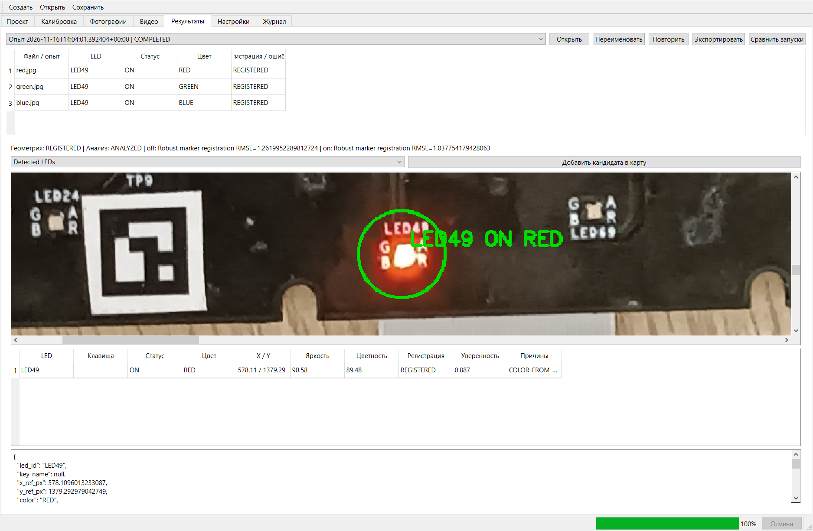
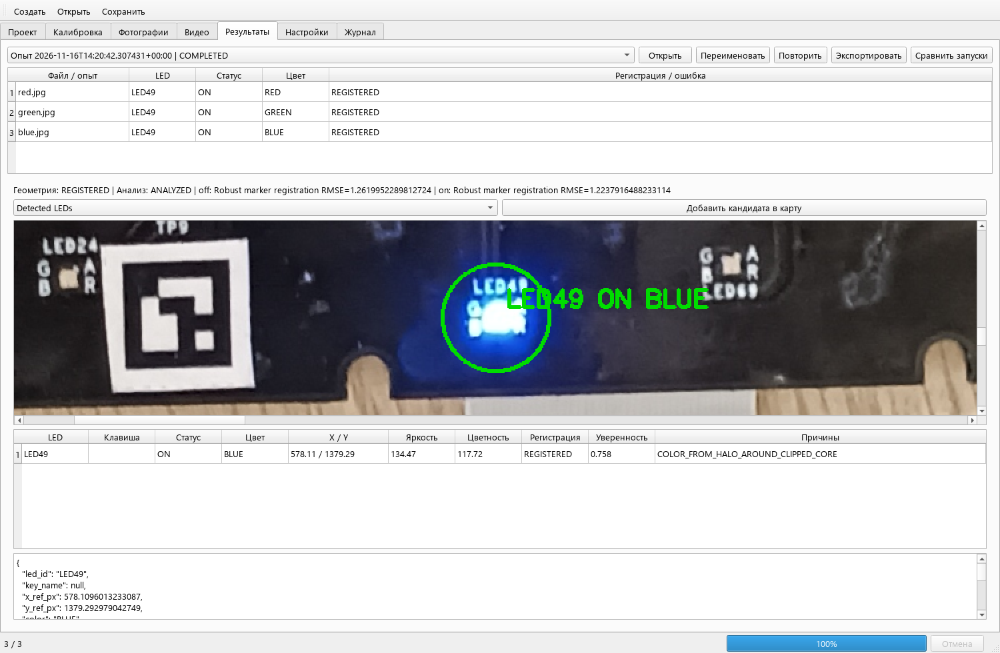

# RGB Vision v0.3 — фактическая приёмка

16.11.2026. Обработаны текущие личные `data/off.jpg`, `red.jpg`, `green.jpg`,
`blue.jpg` и неизменённая карта `config/gs75_board_calibration.json`.
Реальные фото не подменялись синтетическими; SHA-256 и метрики сохранены
в `v03_validation_summary.json` рядом с этим документом.

## Через новый GUI

Создан проект, выбрана карта, четыре фото импортированы действием
мультивыбора, назначены OFF/ON. Нажата кнопка «Анализировать выбранные ON».
Qt-тест использует настоящие виджеты и фоновые задания, подставляя пути
только в системные file dialog. Результаты не подставляются.

| Файл | LED | Статус | Цвет | Регистрация | Второй / первый | Confidence |
|---|---|---|---|---|---:|---:|
| red.jpg | LED49 | ON | RED | REGISTERED | 0.112692 | 0.887308 |
| green.jpg | LED49 | ON | GREEN | REGISTERED | 0.142065 | 0.857935 |
| blue.jpg | LED49 | ON | BLUE | REGISTERED | 0.241862 | 0.758138 |
| off.jpg / off.jpg | LED49 | OFF | UNDEFINED | REGISTERED | — | 0 |

Других ошибочно идентифицированных включённых LED нет. Это проверка одной
точки LED49, не всей платы. Карта и исходные фото остались read-only.
Confidence — эвристическое разделение цвета, не вероятность свечения.

## Причина BLUE → MIXED

Baseline v0.2 воспроизведён: средний положительный RGB для BLUE
**6.162129 / 37.196040 / 134.474505**, результат MIXED. Но голосование цвета
шло по ON-изображению с удалённым нейтральным минимумом, а не по указанному
приращению. Фон и отклик камеры добавляли лишний канал при границе 35%.

v0.3 голосует по компенсированному приросту OFF→ON. Нейтральная составляющая
удаляется на каждом пикселе; белое ядро не голосует за цвет. Новое среднее
свидетельство BLUE RGB=**0 / 31.033911 / 128.312376**, отношение второго
канала к первому **0.241862**, ниже границы одного цвета 0.45.
При ≥0.70 остаётся MIXED, между границами — UNDEFINED/UNCERTAIN.
Границы общие для RGB и доступны в Advanced. Имена файлов и координаты
LED49 не входят в классификатор.

Отдельные тесты проверяют синтетические RGB, yellow/cyan/magenta,
неоднозначную смесь, клиппинг, экспозицию, ракурсы, потерю ArUco, OFF/OFF
и повторный batch без изменения входов. Одна камера/точка не является
универсальной калибровкой всех камер и светодиодов.

## Windows, launcher, MP4

Проверен настоящий backend Qt **windows**, не только offscreen: реальный
результат, затем тестовый MP4 и кадр 6, decoder time=600 мс, без ошибок.
Отдельно проверен Start_RGB_Vision.bat: окно **GS75 RGB Vision v0.3**
в pythonw без постоянной консоли; тестовый экземпляр затем закрыт.





Тест MP4: 8 кадров/10 FPS, синтетическая плата, OFF=0, BLUE=6. Через GUI
проверены seek, предыдущий/следующий кадр, роли и анализ LED49 BLUE.
VideoCapture освобождается при закрытии. Это синтетическое видео;
реальные VFR/MOV/AVI пользователя ещё предстоят. Недоступный timestamp
помечается unknown/null, FPS-время хранится отдельно.

Photos/calibration screenshots сняты offscreen на настоящих фото,
results/video — обычный Windows-запуск. Исходные большие медиа не публикуются.

## Артефакты и проверки

Полный Python-прогон: **70 тестов прошли**. После добавления восстановления
autosave отдельно прошёл новый тест и повторно проверены GUI-сценарии;
итого текущий набор содержит 71 тест. Обе C-регрессии прошли. Настоящий
Windows-запуск и BAT/pythonw дополнительно проверены отдельно от offscreen.

Приёмочные проекты: `build/vision_v03/gui_acceptance_<ID>/`. Указатель на
последний прогон — `build/vision_v03/latest_gui_acceptance.txt`. Внутри:
проект, миниатюры, UUID-отчёты JSON/CSV/PNG и снимки интерфейса.
Native evidence: `native_smoke.json`, `native_results.png`, `native_video.png`,
`demo_blue.mp4` в build/vision_v03. В Git включены компактный summary
и скриншоты, а не большие исходники и полный набор диагностических PNG.

```powershell
.\.venv\Scripts\python.exe -m unittest discover -s tests -p 'test_*.py' -v
ctest --test-dir build/host -C Debug --output-on-failure
```

Прошивка, реальные выходы, прежние hardware-протоколы и карта не изменялись.
Пока нет автоматического анализа всех видеокадров, камеры, звука,
RGB Hardware Control и автоматического восстановления истории после
аварийного завершения процесса. Одна гомография на всё видео не предполагается.
