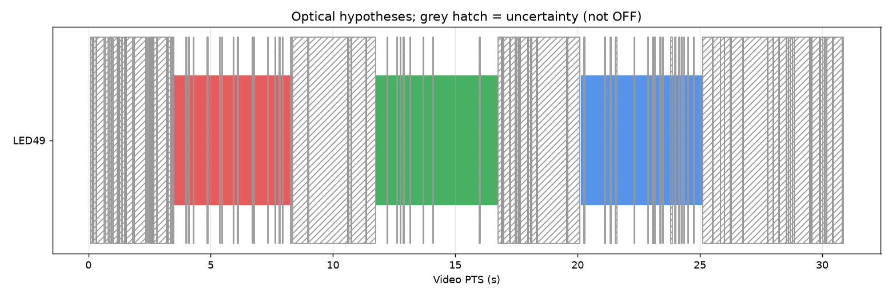

# RGB Vision v0.4.3 — события из видео

Расширение **v0.4.4**: из «Видеоэксперимент» кнопка
**«Анализировать эксперимент»** открывает связанный проект/карту/MP4,
применяет Short-профиль для короткого сценария и после независимых оптических
событий строит электрические/оптические таблицы. Шкала над плеером — основной
результат. Выбор события показывает ток и SOURCE/SINK только при однозначной
связи. «Таблицы соответствий» открывают четыре CSV; «Обновить соответствия»
создаёт новый снимок с текущими ручными решениями.
[Рабочий процесс](short_pulse_experiment.md) · [Схемы и значения статусов](electrical_optical_format.md).

Обычный запуск — **Start_RGB_Vision.bat**, без терминала. Новые зависимости
не требуются: используются прежние PySide6/OpenCV/PyAV/NumPy/Matplotlib.
Прошивка STM32 не меняется; анализ файла не подключается к COM и не включает LED.

## Быстрый сценарий

1. Открыть существующий проект исследования с картой и эталоном. Для KNOWN
   нужны размеченные LED; DISCOVER использует ArUco/координатную основу,
   но координаты LED детектору не передаются.
2. «Видео» → «Открыть видео», выбрать MP4. Сохранены прежние Play/Pause,
   seek, шаги и выбор кадров для фотоанализа.
3. Выбрать KNOWN_LEDS или DISCOVER и профиль длительности.
4. Auto OFF: по умолчанию [0,2) с. Для исследованного реального файла
   это выключенная часть; на другой записи оператор должен выбрать
   подходящий интервал. RGB-последовательность и ожидаемые времена не
   используются для принудительного принятия кадра.
5. При необходимости открыть «Параметры времени», затем «Анализировать видео».
   OFF строится один раз, обрабатываются все кадры, PTS сохраняются.
   Показаны текущий кадр/PTS, число обработанных, состояния, события и ETA.
6. «Отмена» в общей панели кооперативно останавливает обработку на границе
   операции; частичные результаты сохраняются со статусом CANCELLED.
   Ошибка/отмена не показывают успешные 100%.
7. После завершения открывается окно результатов. Его можно повторно
   открыть из истории видеоанализа, которая сохраняется в проекте.

На настоящем `VID_20261117_101549.mp4` обработаны **все 922 кадра**;
[подробная приёмка](video_events_v043/report.md),
[числовые данные](video_events_v043/summary.json).
Поворот −90° применяется один раз. Работа идёт по PTS, не по условным 30 FPS.

## Окно результатов

- Плеер и slider используют номера кадров; временная шкала и события —
  сохранённые PTS. Выбор события переводит к его start_frame. Нажатие
  на шкалу выбирает ближайший наблюдаемый PTS.
- Полосы RED/GREEN/BLUE показывают оптические гипотезы ON. Тёмно-серый OFF
  означает только достоверные OFF-наблюдения. Штриховка — неопределённость,
  включая разрывы внутри гипотезы продолжения; она не подменяется OFF.
- Таблица событий показывает источник, цвет, Start/End PTS, наблюдаемый
  span, статус алгоритма, решение оператора, confidence и флаги.
  По умолчанию выбран фильтр CONFIRMED; остальные сегменты доступны через фильтр.
- DISCOVER имеет отдельный список оптических треков. TRACK0001 — внутренний
  идентификатор гипотезы источника, **не PCB LED ID**.
- «ROI крупнее» центрирует выбранную позицию. Слои Original/Geometry/
  Registered/Coverage/Difference/ROI загружаются по запросу. Geometry —
  проекция опорных меток по сохранённой H, а не повторный поиск ArUco.
  Difference использует уже записанную компенсацию освещения.
- «Экспорт отчёта» создаёт новую папку с JSON/CSV/графиками/raw/решениями.
  Видео не копируется. Исходная папка не перезаписывается.
- «Найти перемещённое видео» проверяет SHA-256 перед реплеем; ссылка хранится
  отдельно в media_link.json, исходный автоматический результат не меняется.



## Пять состояний наблюдений

| Состояние | Значение |
|---|---|
| ON | надёжно обнаружен цветной сигнал в допустимой области |
| OFF | достоверно нет нового света в наблюдаемой области |
| UNCERTAIN | фотометрия/цвет противоречивы или нет достаточного наблюдения |
| INVALID_GEOMETRY | отсутствует надёжная регистрация либо текущий ROI недостаточно покрыт |
| NO_COVERAGE | позиция не покрыта достоверной статической OFF-моделью |

UNKNOWN — внутреннее состояние автомата при отсутствии наблюдаемости,
а не шестое автоматически выдуманное значение OFF. Отсутствие DISCOVER-
кандидата не доказывает выключение; если ROI не измерялся, coverage=null.
Модель OFF сохраняет прежние проверки покрытия; при недостаточности
известных ROI её построение может отказать ещё до анализа событий.

Исходный VideoEngine result сохраняется в frame_results.jsonl. Отдельная
нормализованная CSV-строка содержит raw_state и state, PTS/frame, ID/позицию,
цвет, яркость/цветность, регистрацию/RMSE, покрытие, confidence и причины.
Фильтр не переписывает исходные наблюдения. Счётчики кадров и per-track
наблюдений разделены: в DISCOVER одному кадру может соответствовать несколько строк.

## Временная политика и короткие импульсы

Автомат: OFF → POSSIBLE_ON → ON → POSSIBLE_OFF; при потере видимости UNKNOWN.
События подтверждаются по времени PTS и качественным наблюдениям.
Надёжный OFF всегда разделяет события, даже если это всего один кадр.
Короткий UNKNOWN-разрыв допускает гипотезу продолжения с явным разрывом
доверия. Длинный разрыв разделяет/цензурирует событие. VFR/пропуски
обрабатываются по фактическим временным разностям.

| Параметр | Reliable / Long Pulse | Short Pulse / Experimental |
|---|---:|---:|
| min_on_s | 0,100 | 0,020 |
| min_off_s для потери цветного сигнала | 0,067 | 0,012 |
| max_gap_s | 0,120 | 0,050 |
| min_samples | 3 | 2 |
| минимальная цветность | 40 | 30 |
| минимальная яркость нового сигнала | 45 | 35 |
| уверенность цвета | 0,55 | 0,55 |

Эти значения настраиваются. Надёжный профиль берёт запас над базовыми CV
порогами 25/30; это эвристика качества, не физическая калибровка яркости.
Смена яркости при устойчивом цвете не создаёт новый цветовой сегмент.
Переход цвета без OFF подтверждается во времени; краткий противоречивый
цвет остаётся отклонённым/неопределённым и явно отмечается на шкале.

Для неизвестных позиций учитываются пространственная близость и RMSE:
gate по умолчанию 40 reference px + 3×RMSE, одно наблюдение не назначается
двум трекам. Слабая длительная область не становится CONFIRMED лишь из-за
длительности. Все прежние дополнительные кандидаты исследуются, а не
объявляются ложными заранее.

Проверены 33/67/100/200/300/1000/5000 мс на разных фазах выборки 30 FPS.
Импульс 33 мс может дать один кадр или пройти между выборками. Однокадровое
обнаружение Short — CANDIDATE, не гарантированная длительность; Reliable
может подавить настоящий короткий импульс. Для будущих 10–300 мс нужны
отдельные проверки FPS/экспозиции и возможной синхронизации.

Start/End — PTS первого/последнего ON. duration_s — span между ними,
а не обещание непрерывного физического свечения в UNKNOWN. Signal brackets
и physical bounds раздельны; неизвестная физическая граница — null.
duration_confirmed требует конечных OFF-границ, отсутствия разрывов и
ширины интервала не более 20% span. Confidence — эвристика, не вероятность.

## Ручные решения и карта

«Подтвердить», «Отклонить», «Сбросить» добавляют запись с UTC и источником
OPERATOR в manual_decisions.jsonl. Автоматические events.json/raw остаются
неизменными. В таблице алгоритм и оператор показаны отдельно.

Для существующего LED можно вручную ввести PCB ID по проверенной
шелкографии через «PCB ID вручную». Для новой позиции — «Добавить позицию
в карту»: откроется прежний калибратор с пустым ID, даже при включённой
автонумерации. Пока оператор не подтвердил соответствие, PCB ID отсутствует.
Добавление в карту и оптическое подтверждение — разные решения.

## Журнал PHOTO и производительность

«Связать session.json» работает только после получения независимых событий.
Используются завершённые PHOTO, порядок/цвет и совместимые длительности;
TX/ACK образуют host-интервалы. Конкурирующие временные сдвиги дают AMBIGUOUS;
при одном однозначном сдвиге одна операция может иметь несколько оптических позиций.
Без журнала анализ работает полностью. Часы UTC телефона/ПК не служат
основанием синхронизации. Оценка сдвига не меняет оптические события.

Для реального журнала получено около +2,086 с host относительно video PTS,
наблюдаемый envelope около ±47 мс. Это **не аппаратная синхронизация**:
экспозиция, rolling shutter и цензурированные фронты остаются неизвестными.

GUI/Benchmark используют тот же VideoEngine C_HYBRID и FrameTemporalAnalysis.
При изменении только temporal-профиля GUI использует совместимый completed
run с тем же SHA-256 видео, mode, версией карты и OFF-интервалом. Создаётся
новая папка; decode/ArUco/LED не повторяются. CV FPS остаётся помеченным как
унаследованный, отдельно измеряется пересчёт — его нельзя выдавать за новый
FPS обработки пикселей. В RAM нет всех полноразмерных кадров; для просмотра
индексируются компактные результаты.

## Файлы и CLI

```text
events.json / events.csv
frame_results.jsonl             # исходный компактный VideoEngine result
frame_observations.csv          # нормализованные, но не уничтоженные состояния
unknown_tracks.json
uncertainty_intervals.json
off_coverage.png / timeline.png
video metadata в events.json
calibration_snapshot.json / off_model/
performance_frames.csv
validation_report.md
alignment.json                 # только после post-hoc сопоставления
manual_decisions.jsonl          # только после решения оператора
```

Пакет приёмки: `build/vision/video_events_v043/`, canonical верхний уровень —
KNOWN. `known_verified/` и `discover_verified/` содержат отдельные режимы,
первоначальные полные проходы сохранены в `known/` и `discover/`.
В GUI результаты лежат в UUID-каталогах reports_dir проекта. Большое видео,
фото и полные локальные диагностики в Git автоматически не добавляются.

```powershell
.\.venv\Scripts\python.exe tools/analyze_video.py --video data/VID_20261117_101549.mp4 --mode KNOWN_LEDS --output build/new_known_events
.\.venv\Scripts\python.exe tools/analyze_video.py --video data/VID_20261117_101549.mp4 --mode DISCOVER --output build/new_discover_events
.\.venv\Scripts\python.exe tools/analyze_video.py --reuse build/new_known_events --profile short --output build/new_short_profile
```

Для CLI доступны --min-on, --min-off, --max-gap, --min-samples, --off-start,
--off-duration, --session. Ctrl+C сохраняет частичный CANCELLED. Все output-
каталоги должны быть новыми. Записанный числовой trace в tests/fixtures/
проверяет temporal без изображений; он не доказывает новый OpenCV-прогон,
если исходный MP4 на другом ПК отсутствует.
