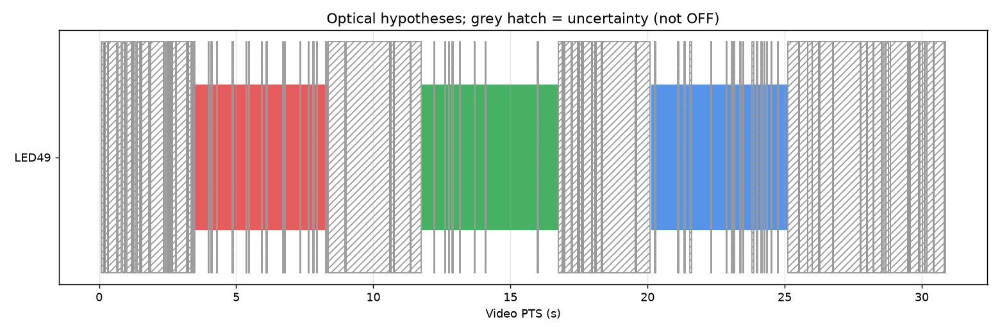
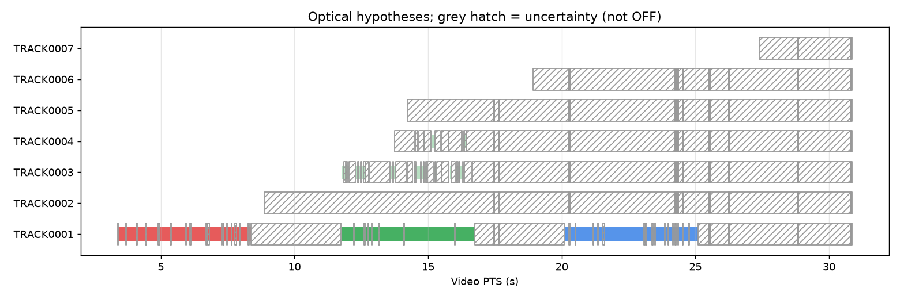

# RGB Vision v0.4.3 — реальный временной анализ

Данные: VID_20261117_101549.mp4, H.264, 922 кадра, контейнер 30,892333 с, 29,91735 FPS, display 1080×1920 / rotation −90°.
Оба режима выполнили один последовательный полный decode/VideoEngine C_HYBRID проход. OFF построен один раз на запуск.
Ожидаемые интервалы/порядок RGB/координаты LED49 не использовались как правила детектора. Последующие изменения только временных
параметров проверены пересчётом компактных исходных результатов без OpenCV и без изменения исходного запуска.

## События KNOWN_LEDS

Найдено ровно **3 подтверждённых события LED49**, дополнительных подтверждённых LED нет. Start/End — PTS первого/последнего
достоверного ON-наблюдения. Span не доказывает непрерывное свечение в UNKNOWN-разрывах и не равен точной физической длительности.

| Цвет | Start PTS, с | End PTS, с | Наблюдаемый span, с | Confidence | Δstart, мс | Δend, мс |
|---|---:|---:|---:|---:|---:|---:|
| RED | 3.382711 | 8.363244 | 4.980533 | 0.813 | +32.711 | -36.756 |
| GREEN | 11.772756 | 16.752767 | 4.980011 | 0.671 | +32.756 | -37.233 |
| BLUE | 20.128978 | 25.108933 | 4.979956 | 0.564 | +28.978 | -31.067 |

Ошибки приведены относительно независимо установленных приблизительных 3,35–8,40 / 11,74–16,79 / 20,10–25,14 с.
Отклонения меньше 38 мс, но сама разметка приблизительная; это не доказательство физической точности 38 мс.
Границы появления/исчезновения цветного сигнала также сохранены как пары соседних PTS в signal_*_interval_s.
При отсутствии надёжного OFF физические границы остаются цензурированными (null), duration_confirmed=false.
Confidence — эвристика качества/покрытия/наблюдаемости, не вероятность.

## Неопределённость и ArUco

Все **922** исходных компактных результата сохранены в frame_results.jsonl; нормализованные строки — frame_observations.csv.
KNOWN: ON=406, OFF=19, UNCERTAIN=408, INVALID_GEOMETRY=89. Последние включают 12 глобальных отказов ArUco и
77 кадров без достаточного покрытия ROI текущей геометрией. NO_COVERAGE для успешной реальной OFF-модели отсутствует; этот gate проверен тестами.
Сохранено **130 интервалов: 52 UNCERTAIN и 78 INVALID_GEOMETRY**. Они не преобразуются в OFF.
Короткие потери допускают гипотезу продолжения с явными unknown_gaps/флагами; длинная потеря разделяет события с открытой границей.
Любой достоверный OFF — жёсткий барьер, склейки через него нет. Цветовые переходы без OFF подтверждаются независимо.
Три события имеют 17/8/17 внутренних разрывов наблюдаемости. Неопределённость между разными событиями не приписывается следующему включению.

## DISCOVER и прежние 68 кандидатов

DISCOVER не получает координаты известных LED. Получены три подтверждённых цветных события одного оптического TRACK0001;
PCB LED ID остаётся null. Всего **7 пространственных треков: 1 CONFIRMED, 2 CANDIDATE, 4 REJECTED**.
Из 471 исходного кандидата 406 наблюдений относятся к устойчивой основной позиции, включая три сместившихся синих ореола;
59 слабых зелёных наблюдений дают два сохранённых кандидата, а 6 смешанных/кратких наблюдений — четыре неподтверждённых трека.
Таким образом прежние 68 наблюдений не объявлены целиком ложными или новыми LED. Слабые устойчивые области требуют проверки оператором.
После временного разбиения имеется 22 сегмента: 3 CONFIRMED, 8 CANDIDATE, 11 REJECTED. Это счётчик сегментов, не число физических LED.
Отдельно сохранены 187 неизвестных интервалов по трекам (126 UNCERTAIN, 61 геометрический). На уровне кадров: ON=406, UNCERTAIN=505, INVALID=11.
Reliable требует сигнал с запасом: chroma≥40 и brightness≥45 (базовые CV-пороги 25/30 плюс 15), устойчивость ≥0,10 с и ≥3 хороших наблюдений.
Это настраиваемые эвристические критерии надёжности, не калибровка яркости. Постоянная слабая позиция остаётся кандидатом, не подтверждается лишь за длительность.

## Производительность

Временной слой принимает только компактные результаты. Ни OFF, ни ArUco, ни измерения LED повторно для него не вычисляются.
Полные прогоны включают decode/CV/temporal и запись JSONL/CSV; OFF/финальные графики отдельно. Замеры разных запусков не являются чистым измерением замедления.

| Режим | Кадров | Wall FPS | Временной слой в полном проходе, мс | На кадр, мс |
|---|---:|---:|---:|---:|
| KNOWN_LEDS | 922 | 21.168 | 47.163 | 0.05115 |
| DISCOVER | 922 | 12.714 | 170.084 | 0.18447 |

В v0.4.2 было около 21,26 / 12,84 wall FPS. Новые значения сопоставимы; добавились журналирование и temporal. 30 FPS не требуются и не заявляются.
Текущий временной код дополнительно измерен отдельно: 10 повторов по записанным 922 наблюдениям, без decode/ArUco/LED analysis; подготовка маски вне секции.

| Режим | Mean temporal/frame, мс | P95, мс |
|---|---:|---:|
| KNOWN_LEDS | 0.02262 | 0.05100 |
| DISCOVER | 0.09017 | 0.25500 |

Полноразмерные кадры не сохраняются в RAM за весь ролик: удерживаются текущий кадр, OFF и небольшие диагностические/ROI данные;
сырые компактные результаты пишутся последовательно. GUI при просмотре индексирует компактный JSONL, поэтому его память растёт с числом наблюдений, не изображений.
Для повторного профиля создаётся новая папка, исходные events/raw остаются неизменными. OpenCV timings при этом наследуются с явным provenance;
быстрый пересчёт не выдаётся за новый FPS обработки пикселей.

## Короткие импульсы и VFR

Проверены 33/67/100/200/300/1000/5000 мс, четыре фазы относительно идеальной выборки 30 FPS. Полные числа — short_pulses.csv.
Reliable: 16 подтверждённых обнаружений, 11 неподтверждённых, 1 MISSED; Short: 24 подтверждённых, 3 неподтверждённых, 1 MISSED из 28 случаев.
Для 33 мс три фазы дали один кадр (неподтверждённое обнаружение), одна прошла между выборками. Это ожидаемая нехватка наблюдаемости, не гарантия камеры.
Все OFF/одиночные отражения в соответствующих тестах дали 0 ложно подтверждённых событий. Истинные короткие импульсы могут подавляться Reliable.
Длительность отдельно подтверждается только при конечных OFF-границах, отсутствии разрывов и ширине интервала ≤20% наблюдаемого span.
У коротких импульсов подтверждение самого обнаружения не означает точную длительность. Используются секунды PTS, не число кадров; есть VFR/пропуски/metadata rotation регрессии.

## Сопоставление с PHOTO

Только после независимых оптических событий загружен завершённый session.json от 2026-11-17_071548. PHOTO ID 3/4/5 сопоставлены по
последовательности/цвету/совместимой длительности. Часы UTC ПК/телефона для этого не использовались.
Оценка host_relative = video_PTS + offset: offset=2.086289 с, наблюдаемый envelope ±0.047044 с.
Это ESTIMATED_NOT_HARDWARE_SYNC. USB TX/ACK и дискретность видео учтены как интервалы; экспозиция/rolling shutter/сдвиг физического свечения остаются дополнительными неизвестными.
Без журнала анализ полноценно работает; несколько подходящих оптических треков дают AMBIGUOUS, не принудительный offset.

## GUI, ручная проверка и тесты

Путь: Видео → открыть MP4 → режим/профиль/OFF-интервал → Анализировать видео. Есть кадр/PTS/ETA/состояния/Cancel.
Окно результатов содержит PTS-плеер, timeline, таблицу событий, оптические треки, seek, сохранённую H/маску/разность и ROI.
Алгоритм и решение оператора показаны раздельно. manual_decisions.jsonl — отдельная история; события/исходные кадры не переписываются.
Добавление позиции в карту всегда требует ручного ID, даже при включённой автонумерации калибратора. Реплей диагностик использует сохранённую H, без повторного ArUco.
Проверен обычный Windows GUI: настоящий MP4, все 922 кадра, 3 события; seek к GREEN=350 и BLUE=600, ROI, PTS-проигрывание, export и post-hoc link.
Во время анализа 578 тиков GUI-таймера, errors=[]. Отдельный повтор через кэш подтвердил исправленные события без OpenCV.
**Финальный полный прогон: 145 Python-тестов PASS за 138,969 с; 2 C-регрессии PASS за 1,35 с.** Включены GUI, записанный real-trace и проверка краткого цветового конфликта.
Оригинальные 643 файла совпали с SHA-256. Прошивка не менялась, COM/стенд агент не запускал.
Переносимый tests/fixtures/v043_real_observations.json.gz содержит числовые записи настоящего видео без изображений и полной карты;
он проверяет temporal, не подменяет новый OpenCV-прогон при отсутствии MP4.

## Файлы и ограничения перед 40-контактным исследованием

Полный локальный пакет: build/vision/video_events_v043/. Верхний уровень — canonical KNOWN;
known/discover — первоначальные полные проходы, known_verified/discover_verified — окончательный пересчёт по тем же raw, gui_acceptance — GUI-проверка.
В Git только компактные JSON/CSV, шкалы и числовая регрессия. Видео/фото/большие диагностики остаются локальными.
Открыты: отражения и слабые источники, неполное покрытие PCB, цветозависимое смещение ореола, точность геометрии,
короткие/пропущенные импульсы при 30 FPS, неизвестная экспозиция, точная оптическая/электрическая синхронизация.
Подтверждённый оптический трек не доказывает PCB ID, физическую коммутацию или непрерывный ток. Для новых контактов нужны независимые
электрические ограничения/операторская идентификация, отдельная проверка FPS/экспозиции и журналов. Массовое аппаратное сканирование в этой задаче не запускалось.
