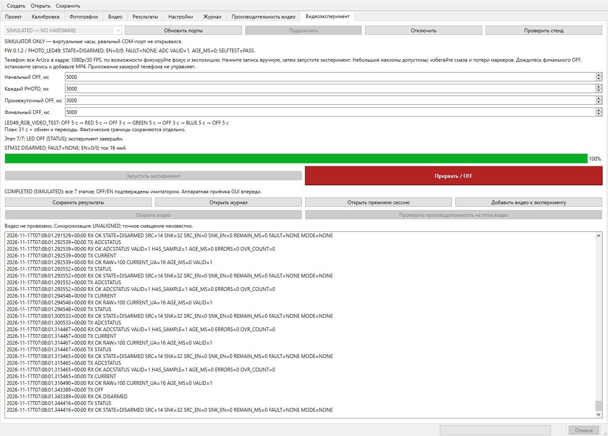

# RGB Vision v0.4.1 — видеоэксперимент LED49

Запуск: **Start_RGB_Vision.bat → «Видеоэксперимент»**. Команды вручную вводить
не нужно. Первичная установка — requirements-vision.txt (добавлен pyserial 3.5);
точное проверенное окружение — requirements-vision-lock.txt. Проект с картой
для электрической последовательности не требуется; для Benchmark нужен
прежний проект с проверенной калибровкой. Программа камерой телефона не управляет.



Скриншот и [пример JSON](examples/v041_simulated/session.json) получены
**имитатором, не настоящей платой**. FW 0.1.2 в этой работе не изменялась,
выходы настоящего STM32 агентом не включались. Новое GUI-управление ещё
предстоит принять оператору на стенде.

## Подключение и запуск

1. Подключить подготовленный STM32 к ПК. Закрыть PuTTY, serial_console.py
   и другие приложения, занимающие тот же COM-порт.
2. «Обновить порты», выбрать фактически обнаруженный порт (например COM19),
   «Подключить». Порт можно ввести вручную. Ошибка доступа отображается во
   вкладке; повторный запуск не выполняется автоматически.
3. Автоматическая диагностика: PING/PONG, многострочный INFO до END INFO,
   STATUS, ADCSTATUS, SELFTEST. Требуются FW **0.1.2**, PHOTO_LED49,
   DISARMED, EN=0/0, FAULT=NONE, VALID=1, HAS_SAMPLE=1, AGE_MS≤5,
   ERRORS=OVR_COUNT=0, SELFTEST=PASS. Кнопка запуска доступна только после
   успеха. «Проверить стенд» повторяет диагностику без ARM.
4. Начать запись на телефоне, нажать «Запустить эксперимент». Состояние
   проверяется повторно. В диалоге отметить все пять физических условий:
   U13 OPEN; R1=2700 Ом; исследуемая RGB-плата; возможность снять питание;
   присутствие оператора и начатая запись. Отмена ничего не включает.
5. После подтверждения снова проверяется стенд, начинается первый OFF.
   До следующего цвета программа доходит только после успешного DONE
   предыдущего, OFF и STATUS с отключёнными EN.
6. Дождаться COMPLETED и финального OFF. Остановить запись на телефоне.
   Выбрать видео в предложенном диалоге либо добавить его позже.

Подключение, открытие вкладки, диагностика и импорт медиа **не запускают
свечение**. Каждый повтор эксперимента требует проверки и нового явного
подтверждения. FAULT не сбрасывается автоматически. Нет PAIR-fallback,
повтора PHOTO, продления ARM или продолжения после ошибки.

## Сценарий LED49_RGB_VIDEO_TEST

| Этап | Состояние | По умолчанию, мс |
|---|---|---:|
| 1 | OFF, начальный фон | 5000 |
| 2 | LED49 RED, KP14→KP32 | 5000 |
| 3 | OFF | 3000 |
| 4 | LED49 GREEN, KP14→KP33 | 5000 |
| 5 | OFF | 3000 |
| 6 | LED49 BLUE, KP14→KP34 | 5000 |
| 7 | OFF, конечный фон | 5000 |

План — **31000 мс**, фактическая сессия длиннее из-за диагностики, обмена и
переходов. GUI позволяет изменить общую длительность каждого PHOTO в
пределах **100…10000 мс**; OFF-паузы — 100…60000 мс. Начальный OFF<2 с
вызывает пояснение о возможной нехватке кадров для фоновой модели.
Для основной видеозаписи оставить 5 с.

Каждый PHOTO — одна непрерывная команда MCU. Перед ней отдельный ARM:
`ceil(duration_ms / 1000) + 5` секунд, то есть 6…15 с. Для пауз ARM не нужен.
После цвета OFF снимает разрешение, поэтому следующий ограниченный ARM
является явно предусмотренной частью подтверждённого сценария. При
ARM_EXPIRED сценарий прекращается; автоматического восстановления нет.

ACK проверяется по LED/цвету/SOURCE/SINK/длительности; DONE — по тому же ID,
PHOTO/LED49/цвету, STATE=OFF, FAULT=NONE, REASON=TIMEOUT, SAMPLES>0,
AVG≤MAX≤2000 мкА, ELAPSED_MS от запрошенного до запрошенного+10 мс.
При PHOTO периодически запрашиваются CURRENT и ADCSTATUS с ограниченным
ожиданием ответа; invalid/stale ADC или ток>2000 прекращают сценарий.
OFF-паузы тоже контролируют STATUS/ADCSTATUS/CURRENT.

AVG<100 мкА считается нештатным для этих проверенных цепей и останавливает
сценарий. Отклонение AVG более чем на 35% от исторических 1035/886/797 мкА
записывается как предупреждение, если жёсткие ограничения не нарушены.
Это диагностическая эвристика, не доказательство калибровки или свечения.
Небольшие расхождения со старыми опытами не создают ложную аварию.

## Прерывание и потеря связи

Красная **«Прервать / OFF»** доступна при подключённом COM во всех этапах.
Она устанавливает событие остановки, прекращает планирование и инициирует
OFF, не дожидаясь DONE PHOTO. Все чтения транспорта ограничены 20 мс,
write_timeout — 250 мс; GUI не выполняет блокирующий обмен. Это программный
механизм с задержками ОС/USB, а не гарантированное время физического отключения.

После OFF ожидаются OK DISARMED и STATUS с EN=0/0 и DISARMED либо FAULT
(FAULT остаётся защёлкнутым). Итог ручной остановки — ABORTED, аварии —
FAILED. При недоступном USB/нет подтверждения показывается, что состояние
выходов неизвестно: оператор должен **физически снять питание**.

Закрытие окна запрашивает остановку, пытается OFF/STATUS, закрывает порт и
дожидается окончания рабочего потока, продолжая обслуживать Qt. Потоки не
уничтожаются принудительно и не оставляются управлять платой после выхода.
При неподтверждённом OFF перед закрытием выводится предупреждение.

**IWDG выключен.** Зависание MCU с запрещёнными прерываниями может помешать
USB OFF и программному таймеру. Наличие R1 и этой кнопки не позволяет
называть стенд аппаратно отказоустойчивым. Питание должно быть доступно.

## Журнал и времена

Каждый явный запуск создаёт новую папку с UTC-датой и случайным суффиксом:

```text
results/video_experiments/<UTC>_LED49_RGB_<unique>/
  session.json
  events.jsonl
  measurements.csv
  report.md
```

Результаты сохраняются автоматически, включая неполные аварийные операции.
«Сохранить результаты» экспортирует отдельную копию; «Открыть журнал»
открывает JSONL средствами Windows. Текущий TX/RX виден и в самой вкладке.
Для позднего импорта выбрать «Открыть прежнюю сессию» → её session.json.
Проверки/отключение после окончания не дописываются в завершённый журнал.
Каталог результатов исключён из Git; пользовательские MP4 автоматически
не добавляются. Пример имитатора сохранён отдельно в docs/vision/examples/.

`session.json`, schema_version=1:

- `app_version`, FW в `diagnostics.info`, `port`, `conditions`, итог safety_check.
- `planned`: номинальные накопленные границы этапов в мс.
- `actual`: начало/конец этапа в monotonic_ns и UTC, host_elapsed_ms;
  для OFF отдельный off_confirmed_ns. От него выдерживается полная пауза.
  Фотоэтап включает preflight/ARM/PHOTO/DONE/OFF; его host_elapsed_ms
  не равен длительности оптического свечения.
- `measurements`: команда, цвет/контакты, ID, сырые ACK/DONE, ack_ns/done_ns,
  avg/max/samples/elapsed_ms/reason/fault/status/warning. При ошибке могут
  отсутствовать поля, ответ на которые не получен; числа не выдумываются.
- `off_confirmed`, `status` COMPLETED/ABORTED/FAILED, `reason`, конец сессии.
- `video`, `video_history`, `synchronization` для будущего совмещения.

`events.jsonl`: одна запись на TX/RX/переход/предупреждение/ошибку,
UTC + `time.monotonic_ns()` + relative_ms от начала сессии. Монотонное время
используется для интервалов; UTC — только ориентир сопоставления.
CSV даёт электрическую таблицу, Markdown — план/факт и ссылки на полные данные.

**TX, ACK и DONE не являются точными оптическими фронтами.** ELAPSED_MS —
квантованный 1 мс MCU-интервал, не измерение света камерой. Номинальные
границы 5/10/13 с никогда не назначаются фактическими переходами.
Виртуальное время примера имитатора ускорено, поэтому его UTC и интервалы
monotonic_ns намеренно не соответствуют реальной длительности записи.

## Видео, просмотр и Benchmark

«Добавить видео к эксперименту» выбирает MP4/MOV стандартным диалогом.
Сохраняются абсолютная ссылка без копирования, размер/mtime, разрешение,
FPS, длительность, stream start_pts/time_base, первый frame PTS и
доступные metadata контейнера/потока. Метаданные читаются в worker.
Полный hash большого видео не рассчитывается: checksum=null с причиной;
размер и mtime не заменяют криптографическую проверку целостности.
Поздняя замена сохраняет video_history.

«Открыть видео» передаёт путь прежнему просмотрщику с seek/выбором кадров;
для простого просмотра проект не обязателен. Сохранение кадров в фотонабор
и Benchmark требуют существующего проекта и карты как прежде.
«Проверить производительность на этом видео» передаёт тот же путь в
существующую вкладку без повторного выбора файла. Измерение запускает
оператор, алгоритмы профилирования не дублируются. Сохранён автоматический
OFF из начальных кадров, по умолчанию [0,2) с.

Синхронизация пока **UNALIGNED**, offset_ms/uncertainty_ms=null. Подготовлены
массив optical_transitions и RGB anchors для будущего поиска оптических
переходов и смещения. Часы телефона/ПК сами по себе не дают синхронизации.
Если фронты не найдены, неопределённость сохраняется, точная привязка не
утверждается. Полный покадровый RGB-анализ в этой задаче не реализован.

## Первое реальное испытание — выполняет оператор

1. При снятом питании подготовить U13 OPEN, R1=2700 Ом и известную LED49.
   Сверить плату/подключение, обеспечить доступ к питанию.
2. Открыть вкладку, выбрать COM19 **или реально найденный** COM.
   «Подключить» → INFO 0.1.2/PHOTO_LED49, DISARMED/EN0, ADC/SELFTEST PASS.
   При несовпадении остановиться; не отключать проверки.
3. Короткая проверка: PHOTO=1000 мс, OFF-паузы оставить штатными. Начать
   запись, подтвердить условия, проверить три DONE, токи, финальные EN0.
4. Отдельный запуск: во время RED нажать красную OFF. Проверить ABORTED,
   DONE REASON=OFF, отсутствие GREEN/BLUE, подтверждение DISARMED/EN0.
   Сохранить обе сессии. При отсутствии подтверждения снять питание.
5. Вернуть PHOTO=5000 мс и штатные OFF 5000/3000/5000. Провести полные
   31 с плюс обмен, проверить COMPLETED, три корректных DONE и EN0.
6. На Redmi Note 11 Pro снимать 1080p/30 FPS, держать все ArUco видимыми,
   по возможности фиксировать фокус/экспозицию. Малые движения допустимы;
   резкие движения, смаз, потеря всех маркеров ухудшают будущую регистрацию.
7. После финального OFF остановить запись. Перенести MP4 с телефона,
   привязать его к соответствующей сессии. Сохранить весь каталог журнала.
8. Открыть проект с картой, передать видео кнопкой Benchmark. Для первого
   построения OFF использовать начальные 2 с действительно выключенной
   платы, затем измерить профиль. Реальная скорость на телефоне ещё не доказана.

Не приписывать новому GUI аппаратную приёмку до получения этих журналов.
Фактические старые опыты FW: [hardware_validation.md](../hardware_validation.md).

## Устройство и программные проверки

| Файл | Роль |
|---|---|
| software/hardware/scenario.py | ограниченный preset, план и версия |
| software/hardware/experiment.py | этапы, диагностика, остановка, измерения |
| tools/photo_led49.py | общий preflight, ACK/DONE/CURRENT/ADC проверки PHOTO; CLI сохранён |
| tools/rgb_probe.py | единственный используемый SerialTransport и парсер fields/integer |
| software/hardware/journal.py | инкрементальные события, JSON/CSV/Markdown |
| software/hardware/video_link.py | внешняя ссылка и PyAV metadata |
| software/gui/experiment_worker.py | один Qt-поток, один владелец COM, Event для OFF |
| software/gui/experiment_pane.py | вкладка, диалог условий, импорт/просмотр/Benchmark |
| software/hardware/simulator.py | виртуальные часы, реальные написания CDC, инъекции ошибок |

Фоновый аппаратный worker отделён от прежнего пула анализа; тяжёлый анализ
не стартует во время эксперимента. GUI не пишет в Serial напрямую. Закрытие
ожидает завершения worker. Нет фоновых дочерних процессов управления.

Тесты tests/test_video_experiment.py и test_experiment_gui.py проверяют
виртуальные 31 с, все семь этапов и OFF-паузы, ARM/PHOTO, ID, токи, длительности,
потерю USB/ACK/DONE/CURRENT, ADC/FAULT/ARM_EXPIRED, Ctrl+C, OFF во время PHOTO,
занятый порт, закрытие GUI, аварийные/повторные журналы и поздний MP4/Benchmark.
Они не открывают настоящие порты. Qt offscreen и отдельный native Windows
снимок прошли; Python CLI, реальные фото, калибратор и прежние видео-пути
проверяются общим регрессионным набором. Точные итоги — PROJECT_CONTEXT.md.
