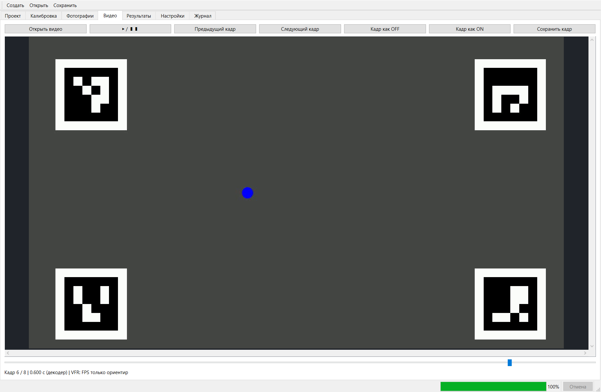

# Видеоимпорт v0.3 — просмотр и выбор кадров

В v0.4-perf дополнительно появилась вкладка
[«Производительность видео»](video_performance.md): последовательный
анализ кадров с новой гомографией, автоматическим OFF, PTS/VFR и событиями.
Это измеряемый benchmark-прототип, не полный прикладной видеоworkflow.
Описанный ниже проигрыватель/выбор кадров v0.3 сохранён.

Открыть Start_RGB_Vision.bat, создать/открыть проект и выбрать карту.
Во вкладке «Видео» нажать **«Открыть видео»**. Поддержаны MP4, MOV, AVI
при наличии декодера OpenCV. Исходный файл подключается ссылкой;
многогигабайтные записи не копируются и не загружаются целиком в память.
При ошибке декодера выводится причина. Конкретные MOV/AVI пользователя
на этой стадии не предоставлены; приёмка выполнена на тестовом MP4.

Доступны Play/Pause, перемотка ползунком, предыдущий/следующий кадр,
номер кадра и время. Декодирование выполняется в рабочем Qt-потоке.
Проигрывание — последовательный предварительный просмотр: фактическая
скорость может быть ниже исходной, звук не воспроизводится.

«Кадр как OFF» или «Кадр как ON» добавляет выбранный кадр в фотонабор
с нужной ролью. Не нужно вручную сохранять файл и импортировать обратно:
программа сама создаёт PNG в `data/captures/frame_<UUID>.png` корня данных,
чтобы проект мог восстановить опыт после перезапуска. В metadata сохраняются
исходное видео, запрошенный и фактический индекс кадра, время и его источник.
Обычная кнопка «Сохранить кадр» позволяет отдельно выбрать PNG-путь.

После выбора OFF/ON перейти во вкладку «Фотографии» и нажать анализ.
Каждый выбранный кадр обрабатывается как самостоятельное изображение,
с собственным поиском ArUco. Матрица между кадрами не переиспользуется.

Используется доступный `CAP_PROP_POS_MSEC`, помеченный `decoder_reported`.
Это показание декодера, а не доказанный аппаратный timestamp. При недоступном
времени сохраняются `timestamp_ms=null`, источник `unknown`; оценка по FPS
записана отдельно как `estimated_ms`. При VFR FPS нельзя выдавать за точное
время. Seek может зависеть от keyframe/backend; сохраняется фактически
выданный индекс, не только запрос.

На проверенном синтетическом MP4: 8 кадров, 10 FPS; OFF — кадр 0,
ON BLUE — кадр 6, decoder time 600 мс. Через GUI и backend проверены
seek назад/вперёд, выбор ролей, анализ LED49 BLUE и освобождение VideoCapture
при закрытии. Файл создаётся воспроизводимо функцией make_video в
tests/test_video_source.py, локальная демонстрация — build/vision_v03/demo_blue.mp4.

Полного анализа всех кадров, трекинга, синхронизации STM32 и камерного
захвата **ещё нет**. Для будущего frame-by-frame анализа VideoReader
выдаёт один кадр с метаданными; обработка каждого кадра должна заново
искать ArUco, поскольку смартфон может двигаться.
