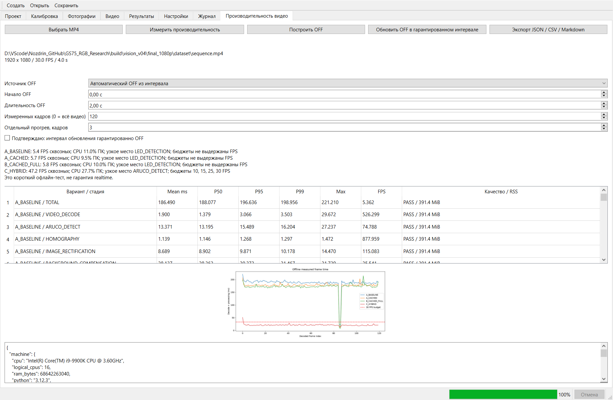

# RGB Vision v0.4-perf — benchmark и автоматический OFF

В v0.4.1 добавлен [видеоэксперимент LED49](video_experiment.md): запись на
телефоне начинается вручную, GUI выполняет OFF/R/G/B/OFF и сохраняет CDC.
После привязки MP4 кнопка передаёт его в эту вкладку без повторного выбора.
Алгоритмы benchmark не менялись; штатные первые 5 с OFF предназначены
для начальной фоновой модели. Оптическая синхронизация пока UNALIGNED.

Запуск прежний: **Start_RGB_Vision.bat**. Открыть проект с картой, перейти
в новую вкладку **«Производительность видео»**, выбрать MP4 и нажать
**«Измерить производительность»**. PowerShell для обычной работы не нужен.
Для новой зависимости один раз обновить окружение по requirements-vision.txt:
добавлен PyAV 19.0.2, чтобы читать настоящие PTS/time_base и VFR.
Ничего автоматически не устанавливается. Прошивка/выходы STM32 не меняются.



## Сценарий GUI

1. Выбрать видео Windows-диалогом. Отображаются размеры, FPS и длительность.
2. Выбрать источник OFF: начало видео либо явно назначенное OFF-фото проекта.
   Для автоматического OFF интервал по умолчанию [0,2) секунды должен быть
   гарантированно выключенным. Можно вручную изменить начало/длительность.
3. Выбрать количество измеренных кадров: 120 по умолчанию, 0 — всё видео.
   Прогрев — 3 кадра отдельным проходом. Измеренный проход начинается с нуля;
   кадры в пределах выбранного объёма не пропускаются.
4. Нажать измерение. Варианты A_BASELINE, A_CACHED, B_CACHED_FULL, C_HYBRID
   обрабатываются последовательно в существующем Qt-worker. Режим
   KNOWN_LEDS/DISCOVER берётся из переключателя приложения. Для KNOWN
   карта обязана содержать хотя бы один LED.
   Сравнение использует фиксированный профиль benchmark: threshold=30,
   color_threshold=25, ROI=40 reference px, min_area=6, RANSAC=3 px,
   dominance/mixed=0,45/0,70. Настройки Advanced фотоанализа не подменяются.
5. Таблица показывает Mean/P50/P95/P99/max/FPS по стадиям, quality/RSS,
   график — время кадров. Сводка показывает сквозной wall FPS, CPU,
   дорогую стадию и проверку бюджетов 10/15/25/30/60 FPS.
6. Экспорт JSON/CSV/Markdown создаёт новый каталог. Диагностика доступна
   в `off_model/off.png`, `valid_mask.png`, `off_model.json`, `benchmark.json`,
   `benchmark.md`, `frames.csv`, `frame_times.png`. Предыдущие отчёты не
   перезаписываются. Выход benchmark находится рядом с другими отчётами
   проекта, но не подменяет фотоисторию.

«Отмена» действует на границах кадров/этапов; отдельный вызов OpenCV/кодека
не обрывается насильно. Checkpoint сохраняет завершённые варианты, текущий
незавершённый вариант при отмене может не войти в отчёт. Закрытие занятого
окна сохраняет прежнюю процедуру ожидания worker.

## Как получается OFF

Декодер последовательно читает интервал. Из него удерживается не более
пяти изображений (для штатного двухсекундного интервала на тесте — четыре).
Каждое выбранное наблюдение получает собственные ArUco и гомографию.
FAILED/DEGRADED для построения фона отклоняются. Также исключаются
сильные изменения света, локальные признаки возможного свечения и
движущиеся светлые/тёмные объекты по абсолютному остатку после компенсации.

После как минимум трёх пригодных наблюдений вычисляется медиана плитками
по 64 строки; вся видеозапись в память не загружается. Валидность пикселя
требует минимум трёх и не менее 80% принятых наблюдений. Вне этой маски
значения сохранены лишь для просмотра/чтения ArUco baseline-вариантом:
они не являются подтверждённым OFF-фоном и не используются для детекции.
Это важно для белых полей маркеров на границе опорной оболочки.

На тесте: 4 наблюдения, 13 440 000 байт удерживаемых кадров/масок,
74,6489% достоверной области. Это не копирование первого кадра.
При недостатке данных выводится причина; выбрать другой интервал.

Проверка отсутствия свечения консервативна и не доказывает электрическое
отключение тёмного/неисправного LED. Постоянный цветной объект может дать
ложный отказ; слабое свечение может остаться незаметным. Оператор обязан
гарантировать OFF-интервал. В данном этапе реального видео ещё нет.

«Обновить OFF» строит новую проверенную модель по выбранному интервалу.
Нужно явно отметить гарантированный OFF; последнее подтверждённое свечение
ON/CANDIDATE запрещает обновление. Маски пересекаются, изображения плавно
смешиваются 50/50. Во время ON автоматической адаптации фона нет.

## Архитектуры

| Вариант | Что измеряется |
|---|---|
| A_BASELINE | Прежний фотоанализ, включая повторную регистрацию OFF и диагностические изображения |
| A_CACHED | Тот же анализ, но OFF зарегистрирован один раз; дополнительный контроль пользы кэша |
| B_CACHED_FULL | Cached OFF + полный кадр, диагностические копии отключены |
| C_HYBRID | ArUco на уменьшенном входе до 1280 px, уточнение углов в исходном разрешении, новая гомография; coarse-плата до 640 px; высокое разрешение в ROI |

Для KNOWN C избегает глобального поиска компонентов и больших RGB-массивов.
Для DISCOVER сначала ищет coarse-кандидатов, затем уточняет каждый в
полном разрешении. Маленькие неизвестные излучатели могут теряться на
coarse-стадии: этот режим требует дальнейшей проверки по B.

При провале уменьшенного поиска или недостаточном покрытии известной ROI
C возвращается к полному поиску ArUco. Затраты fallback включены во время
кадра. На настоящем BLUE этот путь оказался необходим. Защиты по геометрии
не ослаблены. При потере ArUco новые идентичности не назначаются, события
свечения прерываются. Временное подтверждение — минимум два валидных кадра.

Инструментирование: time.perf_counter_ns(), стадии exclusive, FRAME_TOTAL
включает decode и события. Нераспределённая служебная работа остаётся в
FRAME_TOTAL. COLOR_CLASSIFICATION отделена от LED_DETECTION. Создание
диагностических копий учитывается отдельно; PNG графиков, GUI и запись
отчётов вынесены за горячий цикл. Нулевые поля PNG/GUI в строках кадров
означают отсутствие этих операций в цикле, не бесплатный экспорт.

PyAV читает frame.pts * time_base. Неизвестное время остаётся null,
оценка по FPS записана отдельно. CPU — process CPU всех потоков, делённый
на число логических CPU; RSS семплируется раз в 10 ms и не является точным
пиком аллокатора. Декодирование, compute и сквозной wall FPS разделены.
Кэш ранее декодированных видеокадров для FPS не используется.

## Фактический вывод

[Полный отчёт и все стадии](perf_v04/report.md), [машиночитаемый summary](perf_v04/summary.json).

На i9-9900K / 64 GB, synthetic reference 1200×700, 120 кадров/4 с:

| Режим C | Mean ms | P95 ms | P99 ms | Max ms | FPS |
|---|---:|---:|---:|---:|---:|
| KNOWN 1080p | 21,628 | 25,327 | 30,754 | 49,451 | 46,24 |
| KNOWN 1440p | 23,321 | 27,236 | 31,299 | 68,196 | 42,88 |
| KNOWN 4K | 30,057 | 32,398 | 41,813 | 108,431 | 33,27 |
| DISCOVER 1080p | 58,353 | 64,854 | 80,890 | 101,673 | 17,14 |

Все эти показатели — синтетика. Входное разрешение менялось, reference grid
оставался 1200×700; реальная карта 4000×2256, маркеры телефона мельче.
Средние 33 FPS на 4K не означают устойчивые 30: не выполнен запас mean≤25,
есть кадры >100 ms. Короткий бюджет 30 проходит KNOWN 1080p/1440p;
4K — только бюджет 25, DISCOVER — 15. Это оценки короткой выборки,
не гарантия потока. В GUI 1080p mean C=21,127 ms, качество не изменилось.

Ожидаемая польза и измеренный эффект на 1080p:

- OFF cache убрал повторную регистрацию: A 187,948 → A_CACHED 181,965 ms
  (около 3,2%). Сам по себе кэш не решает проблему больших массивов.
- Удаление диагностики: A_CACHED 181,965 → B 171,611 ms (около 5,7%).
- Coarse-фон и локальные ROI: B 171,611 → C 21,628 ms (примерно 7,94×).
  Главная полная стадия LED_DETECTION уменьшилась с 124,92 до 1,64 ms;
  компенсация фона — с 29,10 до 6,56 ms. Теперь заметен ArUco.

Рекомендация для v0.4: C для размеченных LED с обязательным fallback;
B как контроль/путь качества DISCOVER. Следующие эксперименты — реальные
длинные видео с картой 4000×2256, маленькими маркерами и VFR, затем буферы,
адаптивный coarse-scale и ускоренная компенсация. Их пользу пока не измеряли.
Устойчивая работа реального потока на 30 FPS **не подтверждена**.

Старый фотоанализ и его настройки по умолчанию сохранены. Новый видео-
benchmark пока требует camera_model=null: видеоспецифические intrinsics
ещё не проверены. Полного пользовательского видеоworkflow/аппаратной
синхронизации/захвата камеры нет: это измеряемый последовательный прототип.

Вспомогательное воспроизведение для разработчика:

```powershell
.\.venv\Scripts\python.exe tools/benchmark_video.py --synthetic-height 1080 --output build/my_perf_run
.\.venv\Scripts\python.exe tools/benchmark_video.py --video my_video.mp4 --calibration config/gs75_board_calibration.json --output build/my_video_perf
```
